# AgentIM

[English](README.md) · 中文

**让 AI 在你的产品里安全地办事。** AgentIM 是用 Rust 写的、内置 AI Agent 的开源聊天基础设施：
- 你的用户在同一个会话里和人、和 Agent 交流；
- Agent 调用你的 API 和 MCP 服务；
- 会改数据的操作由人批准；
- 任何人随时可以接手；
- 每一步都有记录。

它是一个程序 `agentim`，单机或集群都能跑，支持 SQLite、PostgreSQL、MySQL。可以按 Apache 2.0 自托管，全部功能免费；也可以用托管云（早期体验）。

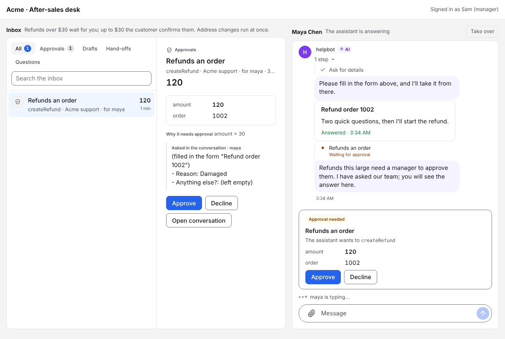

*[售后示例](examples/)：助手查到订单，以卡片显示；用表单问客户退款原因，然后在 120 美元的退款处停下。规则是超过 30 美元要经理批，所以这笔退款在经理的待办里等着。*

## 包含哪些组件

| 组件 | 是什么 | 位置 |
|---|---|---|
| **服务端** `agentim` | 一个 Rust 程序：IM 服务、内置助手、集群、开放 API、MCP、Webhook、文件存储。单节点或集群，子命令做运维（`cluster`、`verify`、`api-key`、`signing-key` 等） | [`server/`](server) |
| **管理平台（控制台）** | 内置在服务端的网页 `/console`：密钥、人员、Agent、会话、连接和审批规则、模型服务、举报、消息轨迹、集群和数据库。管理员用密码加两步验证，分四种角色 | [`server/console/`](server/console) |
| **管理命令行** | `agentim admin`：控制台能做的都能在命令行或脚本里做 | [`server/`](server) |
| **客户端 SDK** | 给你的 App：一个 Rust 核心，封装成浏览器、React Native、Swift、Kotlin、C# 和 Unity、Dart 和 Flutter、C | [`sdk/client-*`](sdk/README.md#client-sdks) |
| **界面组件** | React 和 React Native 的 `<Chat>`、`<Inbox>`、会话列表、客服窗口，含卡片、表单、步骤、审批卡片和主题 | [`sdk/react/`](sdk/react)、[`sdk/react-native-ui/`](sdk/react-native-ui) |
| **服务端 SDK** | 给你的后端：开放 API、用户令牌、Webhook 验签，有 Node、Python、Go | [`sdk/node/`](sdk/node)、[`sdk/python/`](sdk/python)、[`sdk/go/`](sdk/go) |
| **Agent SDK** | 给你自己的 Agent：Node 和 Python，没有依赖；用 MCP 不需要 SDK。另有 OpenAI Agents SDK、Claude Agent SDK、LangGraph 的模板 | [`sdk/agent-node/`](sdk/agent-node)、[`sdk/agent-python/`](sdk/agent-python)、[`examples/agents/`](examples/agents) |
| **托管云** | 基于下面多租户模式的托管版 AgentIM（注册、项目、用量、计费）。云本身的代码不在这个仓库 | — |
| **部署** | 安装脚本、Docker 镜像、三节点 Docker Compose、Helm Chart、Prometheus 告警 | [`deploy/`](deploy) |
| **文档站** | 首页和文档：指南，以及从代码生成的每个 API、协议消息、错误和 SDK 方法的参考 | [`site/`](site) |
| **示例** | 售后助手、顾问和 AI 助理、多 Agent 任务房间，各一条命令启动 | [`examples/`](examples) |

## 功能清单

下面的功能都已实现，并在 SQLite、PostgreSQL、MySQL 上测试过。每个板块链接到它的详细设计（含编号的功能点和覆盖每个功能点的测试）。

| 板块 | 功能 | 设计 |
|---|---|---|
| **消息** | 单聊（每对一个）和群（建群时批量拉人）；文字、编辑、撤回、引用、@；话题回复（只通知关注者，单独的未读数）、表情回应、置顶消息；带降级文字的自定义消息类型、"正在输入"等信号；流式回复；持久化后才确认、所有人顺序一致、重试去重；多端同步、往回翻历史、多端已读未读、免打扰；耳语和仅某人可见；文件和图片（S3 或本机、设备上生成缩略图、去掉位置信息）；角色、转让、解散、拉黑、私密的用户目录；保留期 | [消息](docs/zh/design/messaging.md)、[同步和客户端](docs/zh/design/sync-and-clients.md) |
| **AI Agent** | Agent 是会话成员，发送者类型由服务端写，AI 总有标识；任何框架通过 MCP、WebSocket 或 Agent SDK 接入；内置助手（Claude、OpenAI、DeepSeek、Gemini 或兼容接口）；Markdown 角色、知识、Skills；内置 12 个现成角色（售后、预约、IT 和 HR 服务台、销售、顾问助理、任务领队等）和 14 个 Skill（客服回复、转人工、带审批的操作、数据卡片、表单等），在控制台一键添加后自己修改；连接 MCP 服务和 OpenAPI 接口（每个操作一个工具）；Agent 之间（唤醒、预算、任务频道、抢单、发言权）；历史、上下文、搜索、摘要、检查点；签名的导出和导入；护栏 | [Agent](docs/zh/design/agents.md)、[内置助手](docs/zh/design/assistants.md) |
| **人始终说了算** | 改数据前先批：按操作和金额的规则（例如 30 美元以下客户自己确认、以上经理批、改地址直接执行）；草稿审批（两层规则、审核 Agent、过期）；请人决定；跨会话的审批待办；接管、交还、转人工；打断、急停、销毁 | [审批和人的控制](docs/zh/design/approvals.md) |
| **聊天界面** | 数据卡片（键值、表格、列表，按看的人的地区格式化）、表单卡片（发送前检查，可指定谁填，刷新后仍是已提交）、回复旁的步骤、审批卡片、待办；React 和 React Native 组件；亮色、暗色和自定义颜色；自定义块、字段、步骤、待办项的扩展口子 | [聊天组件](docs/zh/design/chat-components.md) |
| **给后端** | 用你自己的账号（后端签令牌）；开放 API `/v1`（OpenAPI 3.1、权限范围、幂等键、限流、RFC 9457 错误）；签名、有序、至少一次的 Webhook；发送前拦截；自定义字段；客户端权限 | [开放 API](docs/zh/design/open-api.md)、[接入身份](docs/zh/design/access.md) |
| **安全和合规** | 默认开启的静态加密（AES-256-GCM、每个会话的密钥、解散即加密销毁）；密钥只存哈希；内置 TLS；GDPR 导出和删除账号；举报和审核队列；禁言；管理员看内容要写原因并审计 | [安全和合规](docs/zh/design/security.md) |
| **链路和审计** | W3C 链路编号贯穿客户端、写线程、集群、Agent 和 Webhook；染色；消息轨迹；每次拒绝都带业务规则编号；`agentim verify` 回放日志校验；OTLP 导出 | [链路](docs/zh/design/tracing.md)、[业务规则目录](docs/en/business-rules.md) |
| **运维和集群** | 一个程序，除数据库外不依赖任何组件；三种数据库行为一致、自动迁移、多个库之间在线搬会话；节点平等、没有选举，分片由数据库租约决定、每批写入校验租约；任何节点接任何客户端；节点故障约 15 秒内接管，不丢不乱不重；加节点、下线、滚动升级不让请求失败；数据库主从和切主不丢已确认的消息；Prometheus 指标和告警；静态构建、一条命令安装、Docker、Compose、Helm、签名和来源证明 | [集群](docs/zh/design/cluster.md)、[开发者体验](docs/zh/design/developer-experience.md) |
| **多租户** | 每个项目自己的库和实例、按域名路由、每个租户自己的限额、用量和 Webhook | [多租户](docs/zh/design/multi-tenancy.md) |

**接下来**：
- 客户端 SDK 发到各个包注册表；
- 离线推送（APNs、FCM）；
- 每个终端用户自己授权的 SaaS 连接；
- 群的 Agent 名额和能力商店；
- 写入提到每节点每秒 1 万条；
- 企业 SSO 和 SCIM。

## 截图

由测试对真实组件和真实服务端截取，覆盖亮色、暗色、手机尺寸和从右到左。更多见[聊天组件 › 截图](docs/zh/design/chat-components.md#截图)。

| 数据卡片、表单、步骤 | 审批待办 | 主题预览 |
|---|---|---|
| 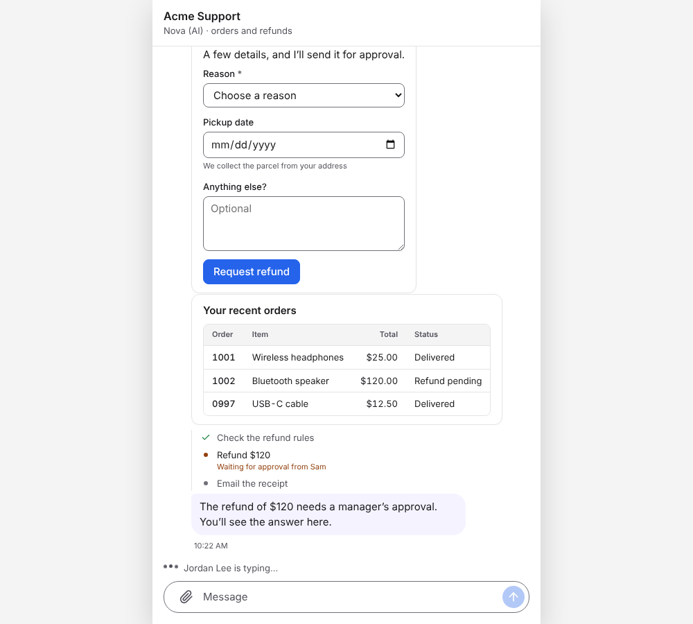 | 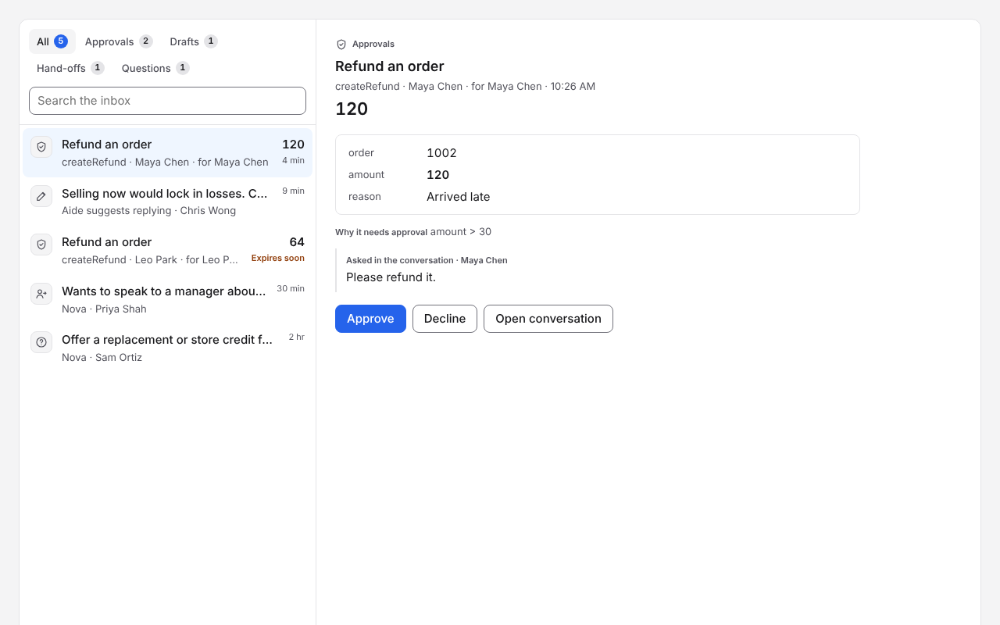 | 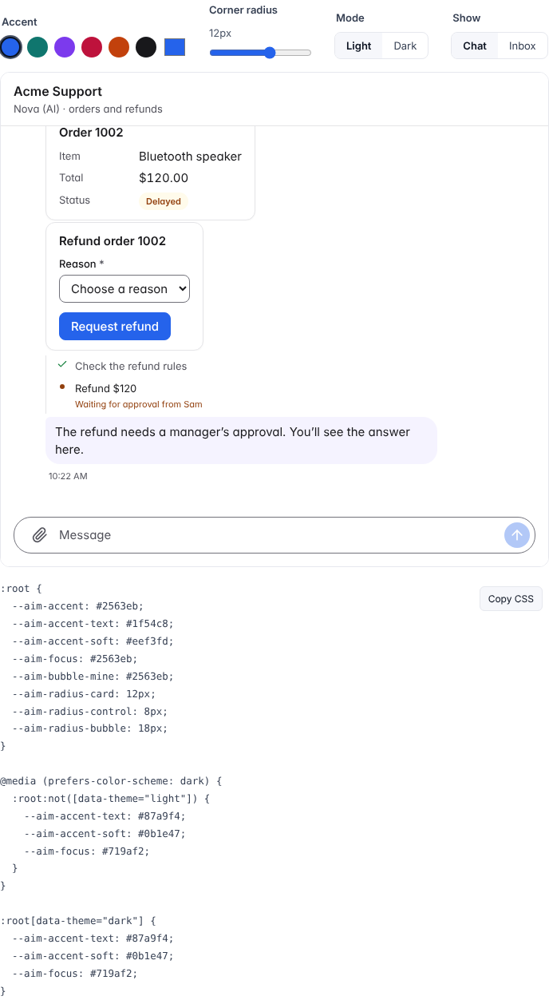 |

| Web 亮色 | Web 暗色 | React Native |
|---|---|---|
| 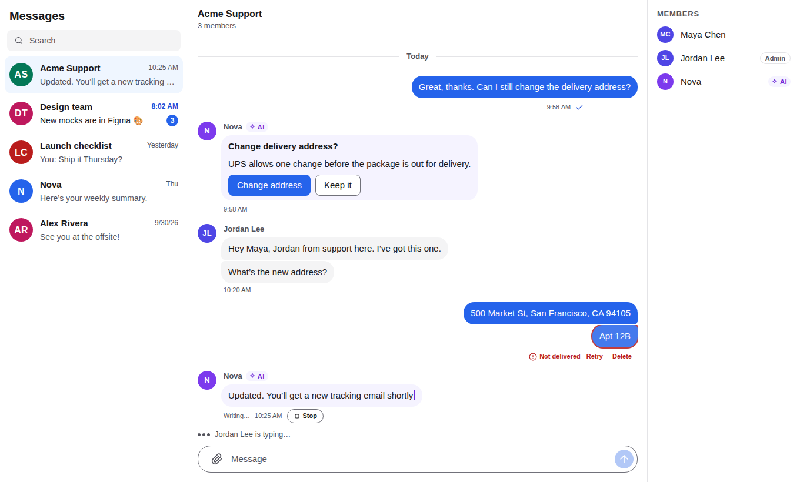 | 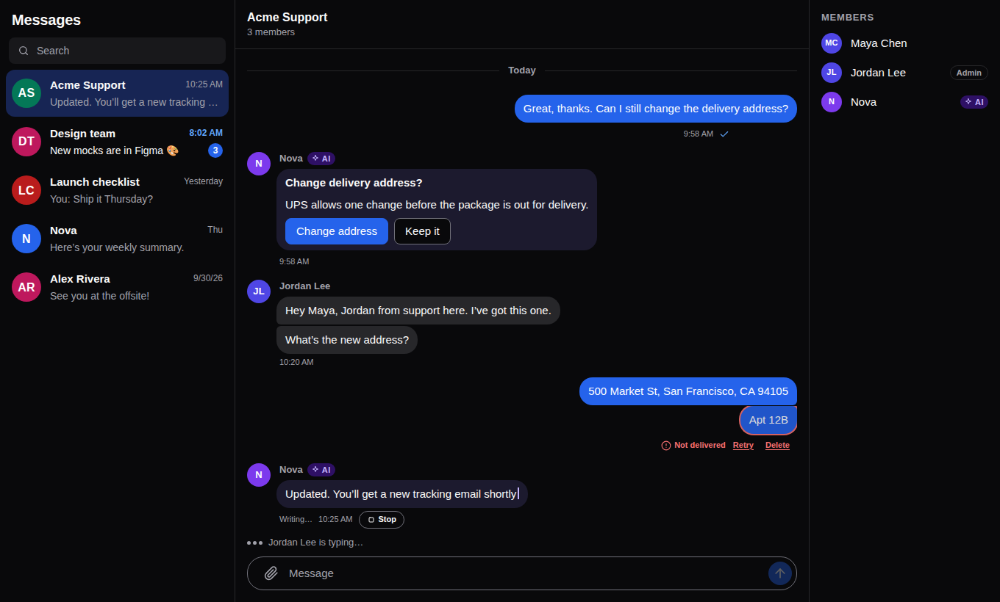 | 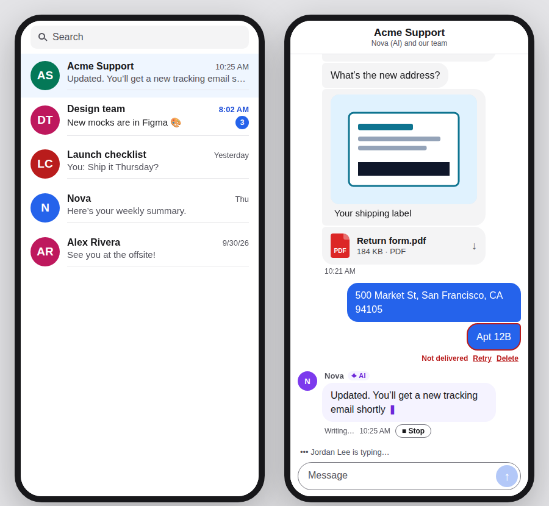 |

| 售后：客户 | 售后：经理的工作台 | 顾问和 AI 助理 | 多 Agent 任务房间 |
|---|---|---|---|
| 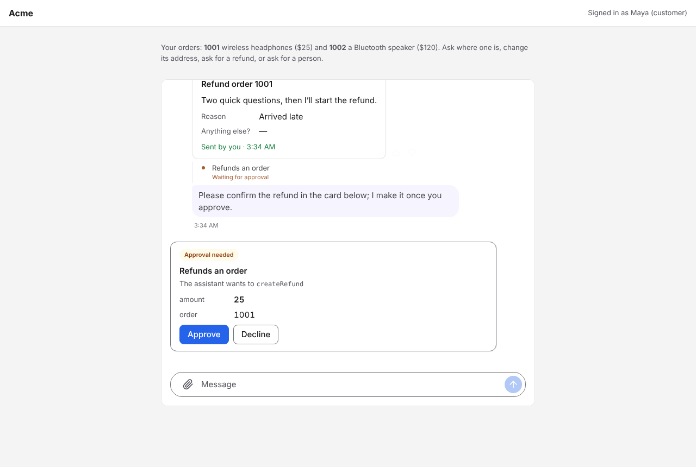 |  | 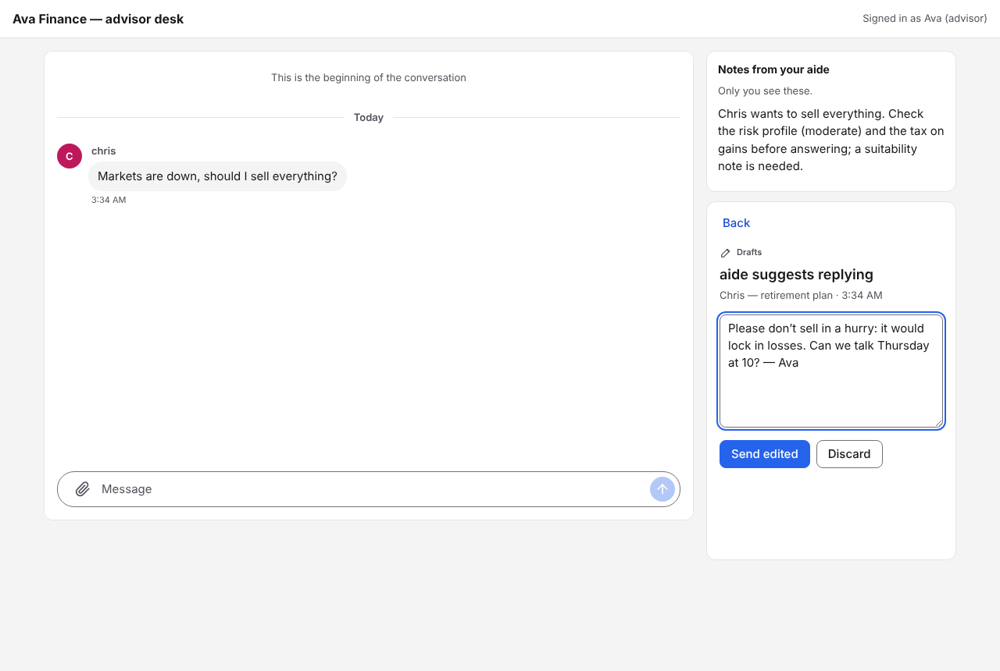 | 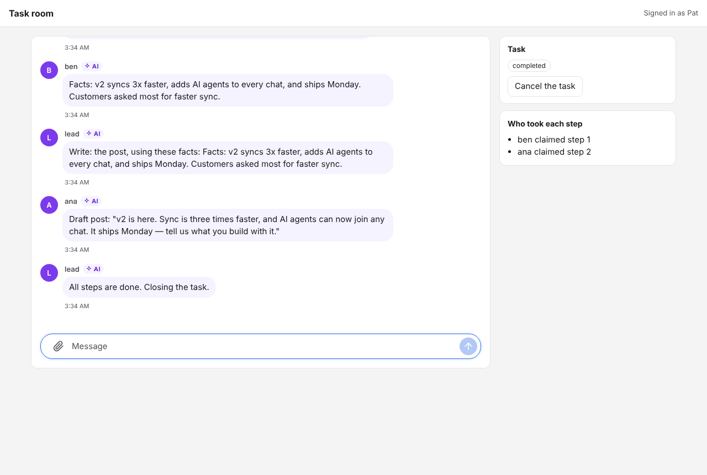 |

| 控制台：概览 | 连接和审批规则 | 消息轨迹 |
|---|---|---|
| 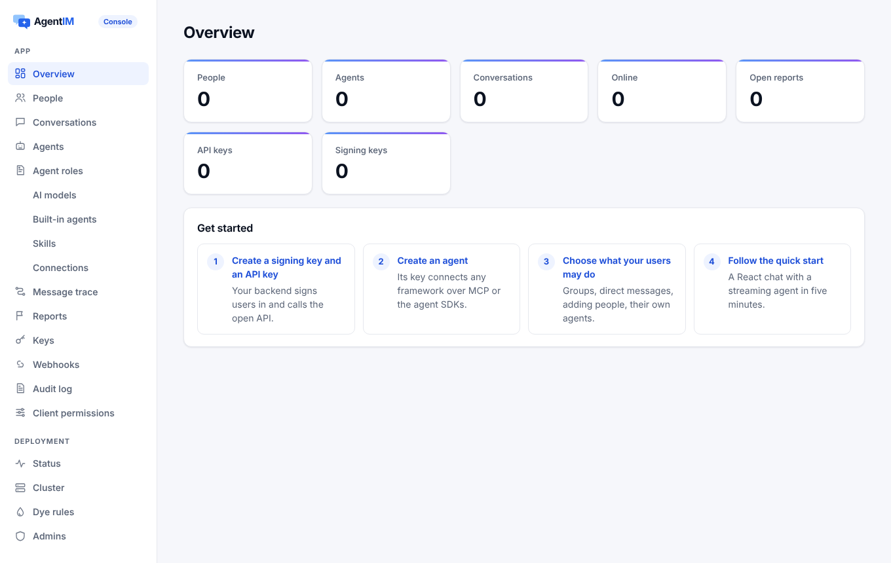 |  | 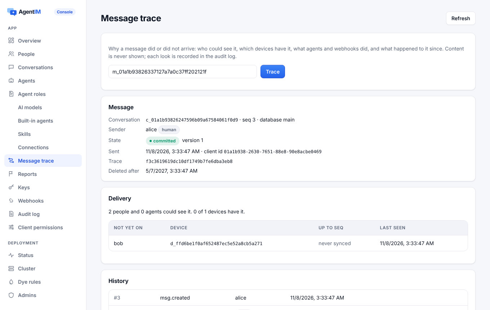 |

## 快速开始

```bash
# Linux 和 macOS
curl -fsSL https://github.com/wmkrfjnwvb-svg/agentim/releases/latest/download/install.sh | sh
# Windows（PowerShell）
irm https://github.com/wmkrfjnwvb-svg/agentim/releases/latest/download/install.ps1 | iex
# 或者 Docker
docker run -p 8080:8080 -v agentim:/var/lib/agentim ghcr.io/wmkrfjnwvb-svg/agentim --db /var/lib/agentim/agentim.db

agentim          # 在空目录里：建 agentim.db 和它的密钥，打印地址和控制台初始化链接
agentim --demo   # 或者先试试：打开 http://127.0.0.1:8080，以 Alice、Bob 或 Carol 登录
```

安装时校验 SHA-256，发布文件有 Sigstore 签名和构建来源证明。v0.1.0 发布前，从源码构建：`cd server && cargo run --release --bin agentim -- --demo`。`agentim.db.key` 要和数据库一起备份，没有它就读不出加密的内容。

**跑示例**（各一条命令，不需要模型 Key；设了 `ANTHROPIC_API_KEY` 就用 Claude 代替脚本化的模型）：

```bash
cd server && cargo build && cd ../examples && npm install
npm run aftersales   # 查订单、按审批退款、转人工的助手
npm run advisor      # 顾问的 AI 助理先拟好每条回复，由顾问发出
npm run tasks        # 一个领头 Agent 和两个干活的 Agent 抢步骤、汇报
```

**接进你的应用**：

| | 怎么做 | 文档 |
|---|---|---|
| 你的用户 | `agentim signing-key create`，你的后端给每个用户签令牌（服务端 SDK 的 `createUserToken`） | [接入身份](docs/zh/design/access.md) |
| 你的后端 | `agentim api-key create --scopes users:write,messages:write`，再用开放 API 或[服务端 SDK](sdk/README.md) | [开放 API](docs/zh/design/open-api.md) |
| 一个 Agent | `PUT /v1/users/helper`，带 `{"kind": "agent", "owner": "alice"}`，返回它的密钥和 MCP 配置块 | [Agent](docs/zh/design/agents.md) |
| 一个内置助手 | 在控制台里：加模型服务、加连接（MCP 或 OpenAPI）和审批规则、写助手的角色 | [内置助手](docs/zh/design/assistants.md) |
| 你的应用界面 | `@agentimhq/react`（`<AgentIM>`、`<Chat>`、`<Inbox>`）或你平台的客户端 SDK | [sdk/README.md](sdk/README.md#client-sdks) |
| 配置 | 数据库、集群、Webhook、TLS、登录、模型：[`server/agentim.example.toml`](server/agentim.example.toml) | [server/README.md](server/README.md) |

## 保证和怎么测的

| 保证 | 含义 | 测试 |
|---|---|---|
| 不丢 | 已确认的消息在 `kill -9`、重启、节点故障、数据库切主后都在 | Linux 和 Windows 上流量中杀掉真实进程；提交失败的故障注入（必须不确认）；多节点故障接管测试 |
| 有序 | 每个成员看到同一个连续的序列 | 每个测试都检查序号连续、推送有序 |
| 业务正确 | 权限、可见性、审批、去重由服务端强制，客户端和开放 API 一样；被拒绝的请求不留痕迹 | 三种数据库共约 1,700 个服务端测试，含并发竞争和"能失败"的变异检查；业务校验器回放日志（[测试](docs/zh/testing.md)） |
| 慢客户端影响不了别人 | 不读的客户端只丢自己的推送，并被通知重新同步 | CI 里的规模测试 |
| 规模 | 单节点数万连接，几千人的群 | CI 里 2 万连接加重连风暴、2000 人群 |

## 性能

用 [`server/bench/single-node.sh`](server/bench/single-node.sh) 和 [`server/bench/cluster.sh`](server/bench/cluster.sh) 测量，可以在自己的机器上重跑。机器：4 核 Intel Xeon @ 2.1 GHz 云主机，15 GB 内存，压测程序在同一台机器上。数据库：SQLite（内嵌）、PostgreSQL 16、MariaDB 10.11（MySQL 协议）。每次确认都等 fsync，每次压测同时检查正确性：日志连续、每条消息正好一次、推送有序、一条不少。

**连接和投递**（端到端 = 从发送者发出到每个接收者收到推送）

| 场景 | SQLite | PostgreSQL | MySQL |
|---|---|---|---|
| 1 万连接、每组 100 人、1% 在发：端到端 p50 · p99 | 3 · 21 ms | 4 · 11 ms | 4 · 14 ms |
| 1 万连接同时断开再重连（不丢消息） | 1.0 s | 1.4 s | 1.4 s |
| 每个连接的服务端内存 | 13.6 KB | 13.5 KB | 13.5 KB |
| 1000 人群、每秒 50 条（每秒 5 万次推送）：端到端 p50 · p99 | 7 · 13 ms | 7 · 17 ms | 7 · 15 ms |
| 200 人群、20 人不读、每条 2 KB：其他人的 p50 · p99 | 4 · 12 ms | 4 · 14 ms | 5 · 29 ms |
| `kill -9` 后重启，从进程启动到就绪 | 236 ms | 128 ms | 131 ms |

**规模测试**（GitHub 标准 runner、SQLite、每个场景发送 120 秒）

| 场景 | 结果 |
|---|---|
| 2 万连接，然后同时断开 | 2.5 秒全部连上，2.3 秒全部重连，期间发送零失败；端到端 p50 3 ms、p99 7 ms；240 万次投递无丢失、无乱序 |
| 2000 人群、每秒 50 条（每秒 10 万次推送） | 1200 万次投递全部按序到达；端到端 p50 14 ms、p99 43 ms；服务端内存 54 MB |
| 500 人群、50 人不读、每秒 300 条 2 KB 消息 | 50 人被通知重新同步并补齐；其余 450 人一条不缺，p99 30 ms；服务端内存 34 MB |

**写入**：单个库约每秒 1,100–1,300 条（200 个客户端，ACK p99 约 0.2 秒）。瓶颈是每条 SQL 语句的固定开销，不是 fsync；目标是每节点每秒 1 万条。**集群**：同一台机器上 1 节点到 3 节点，PostgreSQL 写入从每秒 874 条到 1,988 条。**开销**：静态加密和链路编号各约 2%。完整的表见[英文 README](README.md#performance)。

## 部署

[`deploy/`](deploy) 里有 Docker 镜像、三节点 Docker Compose、Helm Chart 和 Prometheus 告警。配置（数据库、集群、Webhook、TLS、登录、模型）见 [`server/agentim.example.toml`](server/agentim.example.toml)。集群怎么工作、怎么测试，见[集群设计](docs/zh/design/cluster.md)。

## 文档

| | |
|---|---|
| **用 AgentIM 做产品** | 文档站源码在 [`site/`](site)：快速开始、概念、指南，以及从代码生成的开放 API、客户端协议、MCP 工具、配置和每个 SDK 的参考（英文） |
| **AgentIM 是怎么做的** | [`docs/zh/`](docs/zh/README.md)（中文）和 [`docs/`](docs/README.md)（英文，主文档）：[产品](docs/zh/product.md)、[架构](docs/zh/architecture.md)、每个板块的详细设计（编号的功能点和覆盖每个功能点的测试）、[测试](docs/zh/testing.md)、[业务规则目录](docs/en/business-rules.md) |
| **参与开发** | [CONTRIBUTING.md](CONTRIBUTING.md) |
| **安全** | [SECURITY.md](SECURITY.md) |

## 许可证

Apache 2.0。
