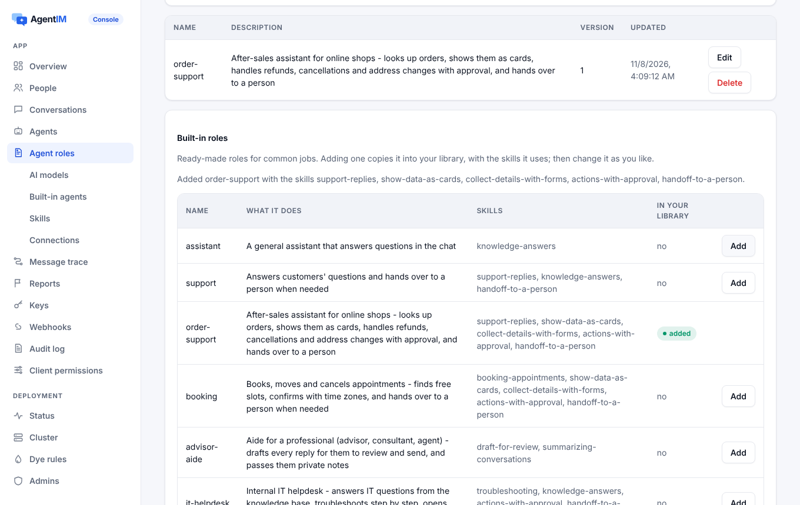

# Built-in assistants

Assistants the server runs itself: model services, the runner, roles, knowledge, Skills, connections to MCP servers and REST APIs, cards and forms, steps, approvals of write operations, limits and usage.

Code: `server/crates/agentim-core/src/ai/` (`provider.rs` model adapters, `prices.rs`, `connect.rs` MCP and OpenAPI clients), `hub/assistants.rs` (the runner and its tools), `hub/knowledge.rs`, `hub/skills.rs`, `hub/connections.rs`, `db/ai.rs`; built-in catalog `server/crates/agentim-core/builtin/agents/`, prices `builtin/prices.toml`.

## 1. Purpose

Many products need an assistant that answers from their documents and does simple work through their API, without running a separate agent service. A built-in assistant is configured in the console (or the admin API) and runs inside `agentim`:
- it joins conversations like any agent;
- it obeys every rule agents obey;
- its write operations wait for approval when the rules say so.

## 2. Feature points

| ID | Feature | Behaviour |
|---|---|---|
| AST-01 | Model services | A service is a provider type, a key and the models it lists. Types: Anthropic Messages, OpenAI Responses, Chat Completions (DeepSeek, Gemini, any compatible). Built-in services use the deployment's key from the environment; app services keep the customer's key encrypted, write-only |
| AST-02 | Prices and usage | A price table per model (input, output, cache read, cache write) ships with the program and can be overridden. Every call records tokens and cost, never the prompt or reply. Built-in keys can use only priced models |
| AST-03 | The runner | Each enabled assistant has an in-process session on the normal protocol. When woken, it builds the context (role, knowledge, the recent conversation within budget), streams the reply, and runs a tool loop (at most 10 rounds) |
| AST-04 | One reply per trigger | The reply's `client_msg_id` comes from the triggering message. Retries, restarts and two runners in a cluster all produce one reply. One node runs each assistant, chosen by rendezvous hashing |
| AST-05 | Roles and the catalog | Instructions come from a Markdown role ([agents](agents.md)). Five templates ship in the catalog: general assistant, translator, meeting notes, support Q&A, moderation |
| AST-06 | Knowledge | Upload md, txt, csv, json and pdf files (5 MB each, 50 per assistant). Text is extracted, chunked and indexed (BM25, English and Chinese). The best chunks go into the context, and replies carry sources. "Answer only from the documents" hands over or replies with a fallback |
| AST-07 | Skills | The Agent Skills format: `SKILL.md` front matter and body, plus `references/`. Names and descriptions go into the prompt; `load_skill` and `read_skill_file` fetch the rest. Scripts are never run |
| AST-08 | Connections | Remote MCP servers (Streamable HTTP) and REST APIs imported from OpenAPI 3, where each operation becomes a tool. Credentials are encrypted. Private and loopback addresses are refused (SSRF) unless `[ai] private_addresses` allows them |
| AST-09 | Write tools | Per connection, `writes` is `read_only` (default, read tools only), `confirm` (ask before every write) or `allow`, plus rules by operation and amount ([approvals](approvals.md#33-operation-approvals)) |
| AST-10 | Cards, forms and steps | `show_card` shows facts, tables and lists. `ask_form` sends a form only the asker can fill in, once; their answers start the next reply. Each tool call is a step titled with the tool's summary, never its arguments. Settings `cards`, `forms`, `steps` (on by default) |
| AST-11 | Hand-off | With `handoff` on, the model gets `handoff_to_person {note}`. The hand-off happens after the reply ends |
| AST-12 | Limits | Replies per minute and per day per assistant, tokens and tool rounds per reply, tokens per day per model service. A limit hit answers with a notice. Rate-limited sends are retried patiently |
| AST-13 | Config for external agents | External agents receive the same role, Skills, MCP servers and API documents in their config. The SDKs can write them to disk (`.claude/skills/…`, `.mcp.json`, `.agentim/apis/…`) |
| AST-14 | Hosted credit | In a hosted project, built-in keys spend the organisation's prepaid credit. The project stops calling them when its allowance runs out |
| AST-15 | Built-in library | 12 roles and 14 Skills ship with the program (`builtin/agents/`, `builtin/skills/`). The console and the admin API list them; adding a role copies it into the app's library with the Skills it names that are missing; the app then owns and edits its copy. Each item shows whether the library has it and whether it is the shipped version; "restore" brings the shipped one back |

## 3. Design

### 3.1 Model services

| Provider | API | Models | Streaming and usage |
|---|---|---|---|
| Claude (Anthropic) | Messages `POST /v1/messages` | `GET /v1/models` | SSE; `usage` in `message_start` and `message_delta` (with cache tokens) |
| OpenAI | Responses `POST /v1/responses` | `GET /v1/models` | SSE; usage in `response.completed` |
| DeepSeek, Gemini, compatible | Chat Completions | `GET /models` | SSE with `stream_options.include_usage` |

The adapters call providers with `reqwest` directly. Model lists come from each provider's API; prices come from `prices.toml`, because providers do not publish prices by API.

### 3.2 The runner

```
woken (mention, direct message, task)          one node per assistant (rendezvous hash)
  │ claim the reply: client_msg_id = ai-<trigger>   (a second runner finds it taken)
  │ context: role instructions + knowledge hits + recent messages within the model's budget
  ▼
model stream ──▶ streaming message (deltas, sources)
  │ tool call?
  ├─ read tool / show_card / load_skill ──▶ run, step done, next round (≤ 10)
  ├─ ask_form ──▶ form card to the asker (once); reply ends; their answers wake the next reply
  ├─ write tool, approval needed ──▶ request_human with context.operation; step "waiting";
  │                                  the model is told it is waiting and says so
  └─ handoff_to_person ──▶ after the reply ends
model error or timeout (120 s) ──▶ "I can't answer right now", logged, no endless retry
```

- **After a decision**: the stored call runs once (a claim on `ai-q-<request>`). The waiting step becomes done or failed, and the model gets the result to tell the person. A decline gives the model the reason. An expiry gives a fixed reply.
- **Forms**: the answers come in as a `card.response`. A claim on `ai-f-{card}-{by}` makes them start exactly one reply, beginning with "Maya filled in the form …" and each value. The form's step is done once it is answered.
- **Steps** are `progress` events of kind `step`, attached to the reply: `{id, state, title, detail}`.

### 3.3 Knowledge

- Files are extracted to text (PDF too) and split into chunks with overlap.
- Chunks are indexed per assistant with BM25. Tokens: words for Latin scripts, bigrams for CJK.
- Retrieval puts the top chunks into the context. The reply's `sources` list the files.
- With "answer only from the documents", a question with no hit is handed over or gets the fallback reply.

### 3.4 Connections

| Aspect | Rule |
|---|---|
| Kinds | `mcp` (URL + auth header) and `openapi` (an OpenAPI 3 JSON document + base URL + auth header) |
| Tools | MCP tools as listed by the server. An OpenAPI operation becomes `{connection}__{operationId}`, with its summary and parameters (`params: [{name, type}]` for the console) |
| Read or write | OpenAPI GET and HEAD are reads; POST, PUT, PATCH and DELETE are writes. An MCP tool is a write unless it is annotated read-only |
| Security | Credentials are stored encrypted and sent only to the connection's own host. Private and loopback addresses are refused unless `[ai] private_addresses = true` (for tests and internal deployments) |
| Saving | Credentials, the document and `approvals` are kept when a save leaves them out |

### 3.5 Limits, privacy and compliance

- Audit and usage record who, which assistant, which model, tokens and cost, never prompts or replies.
- An assistant reads only conversations it is in. Its messages carry the AI label.
- When the deployment's built-in key is used, the model provider is a subprocessor of the deployment. Choosing a provider outside the EU for EU users is a transfer the deployer decides on; the console warns about it.

### 3.6 The built-in library

Templates are the common way to start: Anthropic's Agent Skills repository ships example Skills as folders with a `SKILL.md` and reference files; Claude Code agents are Markdown files with a header; Dify and Copilot Studio offer galleries of ready-made agents to copy and adapt. AgentIM ships the same kind of library, in the same formats, so a built-in role or Skill is also a valid Claude Code agent or Agent Skill.

- **What ships**: roles in `server/crates/agentim-core/builtin/agents/*.md` and Skills in `builtin/skills/<name>/SKILL.md` with `references/`. They are compiled into the program (`library.rs`). Skills are instructions only; scripts are never shipped or run.
- **Installing** copies the item into the app's own library in one write in the control database's writer:
  - A role brings the Skills it names that the library lacks. Skills the app already has (maybe edited) are left as they are.
  - Without `replace`, an item the library already has is refused (`role.exists`, `skill.exists`), and nothing is written, including the role's Skills.
  - `replace` restores the shipped text. For a Skill, files that are not shipped are removed.
  - Agents with the role, or with a role naming the Skill, are told their configuration changed.
- **Status**: `installed` (the library has an item of that name) and `current` (its text is the shipped one). A newer program version can ship newer text; the console then shows the copy as "edited" with a "Restore built-in" button.
- **Enabling a built-in assistant** (`/admin/v1/app/assistants/catalog/{name}`) installs the role and its Skills the same way when the role is missing.

| Role | For | Skills |
|---|---|---|
| `assistant` | General Q&A in the chat | knowledge-answers |
| `support` | Customer questions, hands over when needed | support-replies, knowledge-answers, handoff-to-a-person |
| `order-support` | After-sales: orders, refunds, cancellations, address changes with approval | support-replies, show-data-as-cards, collect-details-with-forms, actions-with-approval, handoff-to-a-person |
| `booking` | Books, moves and cancels appointments | booking-appointments, show-data-as-cards, collect-details-with-forms, actions-with-approval, handoff-to-a-person |
| `advisor-aide` | Drafts replies for a professional to send; private notes | draft-for-review, summarizing-conversations |
| `it-helpdesk` | Internal IT questions, troubleshooting, tickets | troubleshooting, knowledge-answers, actions-with-approval, handoff-to-a-person |
| `hr-helpdesk` | Internal HR policy questions and requests | knowledge-answers, collect-details-with-forms, handoff-to-a-person |
| `sales` | Prospects' questions, lead form, booking a call | knowledge-answers, collect-details-with-forms, booking-appointments, handoff-to-a-person |
| `notes` | Meeting notes and summaries | meeting-notes, summarizing-conversations |
| `translator` | Translates messages | translation |
| `moderator` | Reminds of community rules, reports | content-moderation |
| `task-lead` | Leads multi-agent tasks | task-coordination, summarizing-conversations |

Skills: `support-replies`, `handoff-to-a-person`, `actions-with-approval`, `show-data-as-cards`, `collect-details-with-forms`, `knowledge-answers`, `booking-appointments`, `draft-for-review`, `troubleshooting`, `summarizing-conversations`, `meeting-notes`, `translation`, `content-moderation`, `task-coordination`.



## 4. Interfaces

- Admin API (console):
  - `/admin/v1/app/library/roles`, `/admin/v1/app/library/skills` (list), `POST …/library/roles/{name}`, `POST …/library/skills/{name}` (install; body `{"replace": true}` to restore);
  - `/admin/v1/app/model-services`;
  - `/admin/v1/app/assistants` (settings `cards`, `forms`, `steps`, `handoff`, limits, knowledge-only);
  - knowledge files, `/admin/v1/app/skills`, `/admin/v1/app/connections` (with `approvals`).
- Configuration: `[[ai.builtin]]` for the deployment's own services (keys from environment variables), `[ai] private_addresses`.
- Tools the model sees: `load_skill`, `read_skill_file`, connection tools, `show_card`, `ask_form`, `handoff_to_person`. Knowledge is searched by the runner before each reply, not by a tool.
- Agents' config: `welcome.config`, `get_config`, `GET /api/agent/skills/{name}/files/{path}`.

## 5. Rules and errors

Rule prefixes: `model_service.*`, `assistant.*`, `knowledge.*`, `skill.*` (including `skill.catalog`, `skill.exists`), `role.*` (`role.catalog`, `role.exists`), `connection.*` ([catalog](../business-rules.md)). Admin requests with bad input are `bad_request`; unknown ids are `not_found`; deleting something in use is `conflict`. Failures at run time are answered in the chat with a notice, not with an error to anyone.

## 6. Tests

Paths under `server/crates/agentim-core/tests/`; three databases. Model providers and MCP/API servers are local fakes that speak the real formats.

| Feature | Tests |
|---|---|
| AST-01, AST-02 | `model_services.rs`: `anthropic_messages_stream`, `openai_responses_stream`, `chat_completions_stream`, `built_in_services_use_the_deployment_key`, `services_are_added_checked_and_listed`, `services_survive_a_restart`, `race_creating_services_against_the_limit`, `refusals_leave_no_trace` |
| AST-03, AST-04, AST-05 | `assistants.rs`: `a_built_in_agent_answers_in_the_chat`, `race_many_messages_and_two_runners`, `refusals_leave_no_trace` |
| AST-06 | `assistants.rs`: `knowledge_files_answer_questions`, `knowledge_refusals_and_limits` |
| AST-07 | `assistant_tools.rs`: `skills_are_loaded_when_needed` |
| AST-08 | `assistant_tools.rs`: `connections_give_tools`, `refusals_leave_no_trace` |
| AST-09 | `assistant_tools.rs`: `writes_wait_for_approval`, `approvals_by_operation_and_amount` |
| AST-10, AST-11 | `assistant_tools.rs`: `cards_forms_and_steps`; `examples/test/e2e.mjs` (after-sales: order card, refund form, steps, approvals, hand-off) |
| AST-12 | `assistants.rs`: `failures_and_limits_answer_with_a_notice` |
| AST-13 | `roles.rs`: `agents_get_their_config_at_login_and_when_it_changes`; `sdk/agent-node/e2e.mjs` and `sdk/agent-python/e2e.py` (files written to disk) |
| AST-14 | `assistants.rs`: `hosted_projects_spend_their_ai_credit` |
| AST-15 | `library.rs`: `every_role_is_valid_and_its_skills_are_built_in`, `every_skill_is_valid_and_used`; `tests/library.rs`: all 8 tests (listing, a role with its skills, a skill with its files, replace and current, what agents receive, refusals leave no trace, restart, races with one winner, mutation-checked); `assistants.rs`: `a_built_in_agent_answers_in_the_chat` (enabling installs the skills); `server/ci/console_smoke.mjs` |

## 7. Limits and next steps

- Per-user OAuth connections to SaaS apps (Slack, Salesforce, Gmail) are not built.
- Skill scripts are not run, because there is no sandbox.
- Knowledge search is keyword-based (BM25). There are no embeddings.
