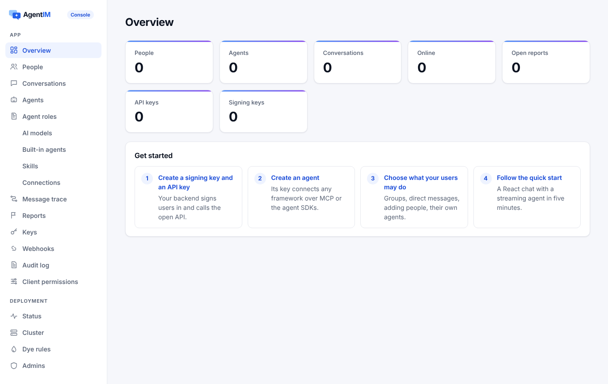
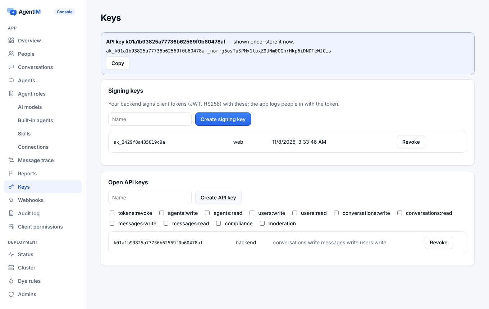
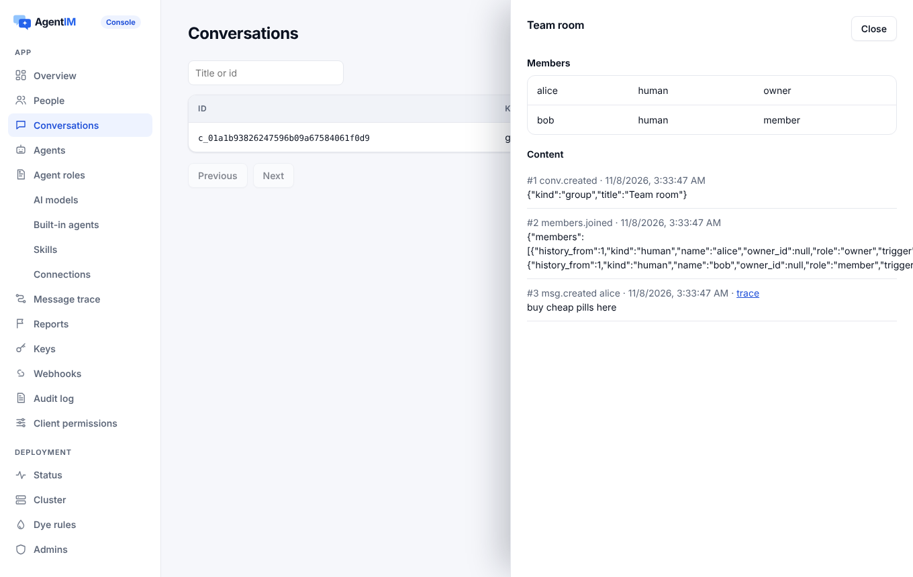
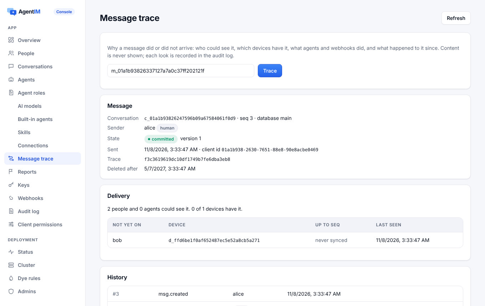
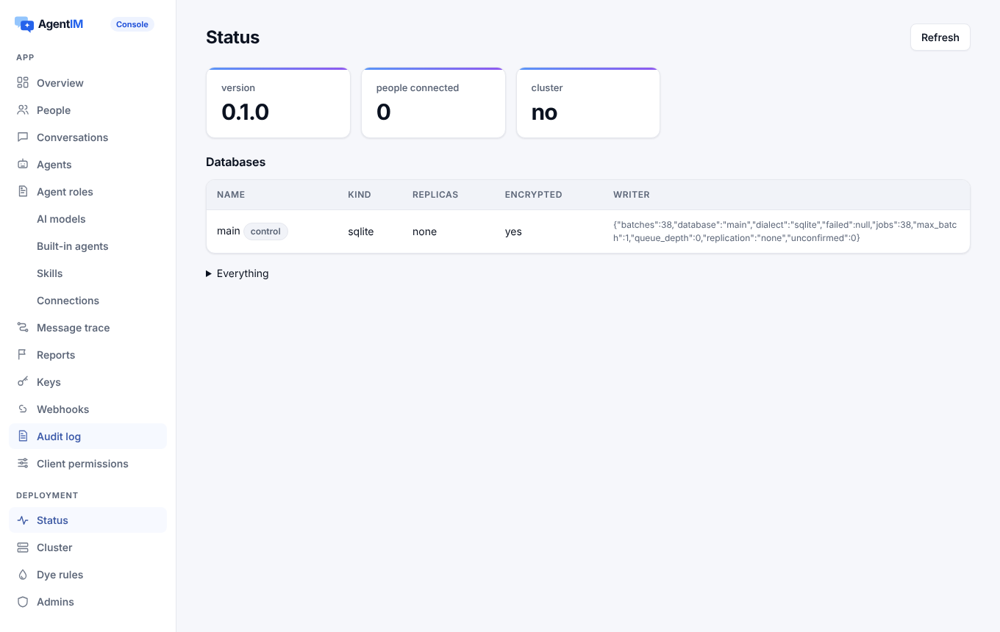
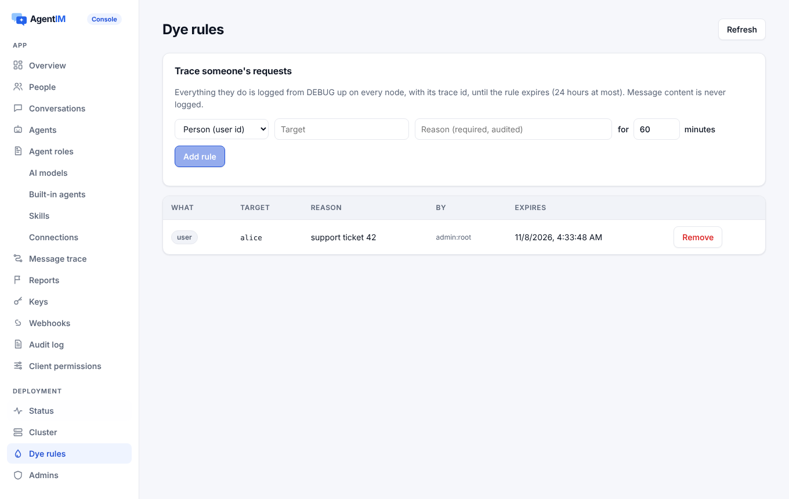
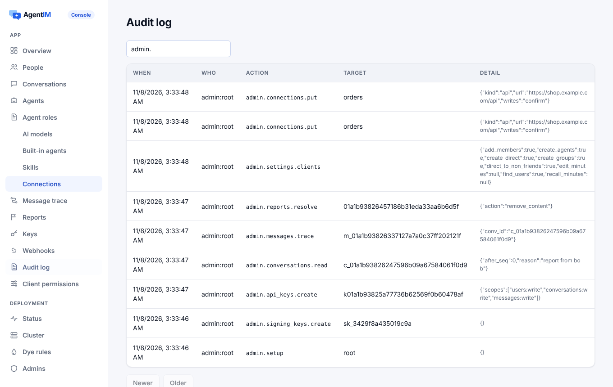

# Developer experience

Everything that makes AgentIM quick to adopt: installation and the first run, releases and their signatures, client SDK packages, the console, the docs site and the examples.

Code: `deploy/` (Dockerfile, install scripts, Compose, Helm, release checks), `.github/workflows/` (`release.yml`, `sdk-packages.yml`, `sdk-release.yml`, `deps.yml`, `site.yml`, `server.yml`, `scale.yml`), `server/console/`, `server/demo/`, `site/`, `examples/`, `sdk/version.sh`, `CHANGELOG.md`.

## 1. Purpose

| Target | Measure |
|---|---|
| From download to the first message | Under 5 minutes |
| From sign-up to the first agent replying | Under 10 minutes |
| Chat and an assistant in a Next.js app by following the docs | Under 30 minutes |
| Each example running with one command | Yes (1.7 s from start to the first agent reply) |

## 2. Feature points

| ID | Feature | Behaviour |
|---|---|---|
| DX-01 | Prebuilt binaries | Linux x86_64 and aarch64 (static musl), macOS x86_64 and arm64, Windows x86_64, each with a SHA-256. Built with a pinned Rust version, without a cache, `--locked`, with the console embedded |
| DX-02 | One-command install | `install.sh` and `install.ps1` install into the user's directory without root. They check the SHA-256 (and refuse to install without a checksum tool), install a chosen version with `AGENTIM_VERSION`, and replace the binary atomically |
| DX-03 | Signatures and provenance | Every release file has a Sigstore bundle and a GitHub build provenance attestation. Third-party Actions are pinned to commits |
| DX-04 | Images and Helm | `ghcr.io/<owner>/agentim` for amd64 and arm64, from the same static binary, user 10001, with an SBOM, signed. The Helm chart is an OCI package with the same version |
| DX-05 | The first run | `agentim` in an empty folder creates `agentim.db` and `agentim.db.key` (0600; refused if others can read it) and prints the address and a one-time console setup link. `agentim --demo` starts with demo people and agents |
| DX-06 | Versions and changelog | Semantic versions. The program, the chart, the tag and the `CHANGELOG.md` section must agree, or the release stops at once |
| DX-07 | Dependency checks | `cargo-deny` (advisories, permissive licences only, crates.io only) and npm audits before every release and by hand |
| DX-08 | Client SDK packages | One version for all packages, released on `sdk-v*` tags, after every package is built and tested. Run by hand, the same build and tests run without uploading. Registries with OIDC publishing (npm, NuGet, pub.dev) need no stored secrets |
| DX-09 | Swift package repository | SwiftPM needs `Package.swift` at the root of a repository, so the release commits the package to [`agentim-swift`](https://github.com/wmkrfjnwvb-svg/agentim-swift) and tags it. The XCFramework is on the release, with its checksum |
| DX-10 | The console | A React app embedded in the binary at `/console` ([access](access.md)). Pages: overview, keys, people, agents, assistants, model services, connections and approval rules, roles, Skills, conversations, reports, webhooks, audit, settings, message trace, dye rules, cluster and databases, admins |
| DX-11 | The demo | A web app (React, on the browser SDK and the components) embedded with `--demo`, with demo people and scripted agents |
| DX-12 | Docs site | `site/` (Astro + Starlight): the homepage, Cloud, pricing and benchmarks pages in English and Chinese (`/zh/`), with the product shown live through the React components; quick start, concepts, guides, the theme preview, and references generated from the source. CI fails when an endpoint, protocol message, error, rule or SDK method has no page |
| DX-13 | Examples | Three apps, each started by one command, needing no model key: the after-sales assistant, the advisor with an AI aide, and the multi-agent task room. There are also templates for the OpenAI Agents SDK, Claude Agent SDK and LangGraph |
| DX-14 | Benchmarks anyone can run | `server/bench/single-node.sh` and `server/bench/cluster.sh` print the README tables |

## 3. Design

### 3.1 Releases

- **On a `v*` tag**, `release.yml` builds the five targets and installs and runs them for real on Linux, macOS (also Intel under Rosetta) and Windows:
  1. install from a local download address;
  2. `--version`;
  3. start in an empty folder;
  4. check `/readyz`;
  5. send and read back the first message through the open API (`deploy/smoke/first_message.py`);
  6. install again as an upgrade;
  7. refuse a tampered archive.
- **The image** installs the same static binary. Before pushing, each architecture is started once (arm64 under QEMU).
- **Before anything is published**, the whole test suite (`server.yml`) runs. Run by hand, the whole release runs without uploading.

### 3.2 Client SDK packages

| Package | Contents | Tested by |
|---|---|---|
| Native library `libagentim_client` | Linux x64/arm64 (glibc 2.28), macOS x64/arm64, Windows x64 | The C ABI test on each platform |
| XCFramework | iOS device and simulator, macOS; headers and module map | Swift scenarios on macOS; a build for the iOS simulator |
| NuGet `AgentIM.Client` | net8.0, netstandard2.1, native libraries per runtime | Installed into a new project on three systems; sends a message to a real server |
| npm (browser, React, React Native UI) | Checked `npm pack` contents | Unit and end-to-end tests |
| npm `@agentimhq/client-react-native` | A C++ TurboModule (JSI), autolinked; native cores for 4 Android ABIs and iOS | A test app in the Android emulator and the iOS simulator |
| Unity `com.agentim.client` | UPM tarball: the same C#, plugins for Android, iOS, macOS, Windows and a WebGL `.jslib`; fixed `.meta` GUIDs | Package checks; the WebGL bridge in Node |
| Android `com.agentim:client` | An AAR for 4 ABIs with 16 KB pages, POM, sources and javadoc; a Central Portal bundle | An app depending on the AAR, in the Android emulator |
| Flutter and Dart `agentim_client` | Dart FFI with a build hook that downloads and checks 12 prebuilt libraries (or builds with cargo in this repository) | The Dart VM on three systems, a Linux Flutter app, the Android emulator |

### 3.3 The docs site

- Hand-written pages live in `site/src/content/docs/`.
- References are generated from the code by `site/scripts/reference.mjs`, `sdk.mjs` and `add-docs.mjs`:
  - the open API (from `/v1/openapi.json`);
  - the client protocol (from `protocol.rs`);
  - MCP tools, configuration, errors and business rules;
  - every SDK's public API.
- `site/scripts/complete.mjs` fails the build when something has no page.
- `site.yml` builds the site on every change, and Cloudflare builds it from the repository.

### 3.4 Console screenshots

Taken by `server/ci/console_smoke.mjs` against a real server.

| Overview | People and keys | Connections and approval rules |
|---|---|---|
|  |  |  |
| **A conversation (content needs a reason)** | **Message trace** | **Deployment status** |
|  |  |  |
| **Dye rules** | **Audit log** | |
|  |  | |

## 4. Interfaces

- Commands: `agentim` (first run), `agentim --demo`, `agentim admin …`, `agentim cluster …`, `agentim verify`, `agentim encryption …`, `agentim api-key|signing-key|admin-key|token …`.
- Workflows:
  - `release.yml` (`v*`);
  - `sdk-packages.yml` (`sdk-v*`, by hand);
  - `sdk-release.yml` (`sdk-v*`);
  - `deps.yml`, `server.yml` (every release, by hand), `site.yml`, `scale.yml` (by hand). CI does not run on pushes or pull requests.

## 5. Rules and errors

The first run refuses to start when:
- the key file can be read by others;
- the master key is wrong;
- the database's durability settings are unsafe.

Each refusal says what to do.

## 6. Tests

| Feature | Tests |
|---|---|
| DX-01–DX-04, DX-06 | `.github/workflows/release.yml` run by hand (no upload); `deploy/release/` version checks; `deploy/smoke/first_message.py` |
| DX-05 | `server/crates/agentim/tests/cli.rs`: `the_first_run_needs_nothing`, `the_demo_refuses_a_public_address`; `encryption.rs`: `a_single_sqlite_database_gets_a_generated_key`, `the_master_key_is_checked` |
| DX-07 | `.github/workflows/deps.yml` |
| DX-08, DX-09 | `.github/workflows/sdk-packages.yml` (every package built, installed and run); `sdk/version.sh`; `sdk/check-npm-pack.mjs`; `sdk/client-swift/test-xcframework.sh`; `sdk/client-dotnet/test-package.sh`; `sdk/client-flutter/test-package.sh`; `sdk/client-react-native/test-app.sh` |
| DX-10 | `server/ci/console_smoke.mjs` (31 checks in a browser against a real server, including the approval-rule editor and assistant switches); `admin_api.rs` |
| DX-11 | `http.rs`: `demo_endpoints_work_in_the_demo`; `server/ci/ui_smoke.mjs` |
| DX-12 | `site/scripts/complete.mjs` in `site.yml` |
| DX-13 | `examples/test/e2e.mjs` (all three apps end to end in a browser) |
| DX-14 | `server/bench/` |

## 7. Limits and next steps

- The client SDKs are not on their registries yet: the accounts, namespaces and signing keys must be set up first.
- Not done:
  - macOS notarisation and Windows Authenticode, which need paid certificates;
  - Unity editor tests, which need a licence;
  - tests on real devices.
- Most app settings beyond client permissions are read-only in the console.
