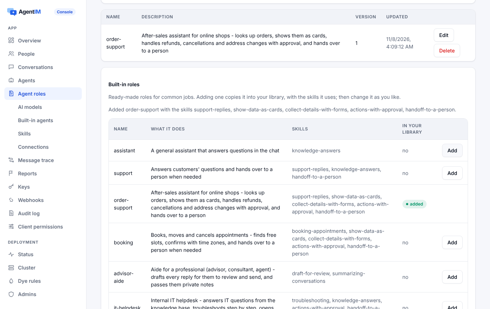

# 内置助手

服务端自己跑的助手：模型服务、运行器、角色、知识、Skills、连接 MCP 服务和 REST API、卡片和表单、步骤、写操作的审批、限额和用量。

代码：`server/crates/agentim-core/src/ai/`（`provider.rs` 模型适配、`prices.rs`、`connect.rs` MCP 和 OpenAPI 客户端）、`hub/assistants.rs`（运行器和它的工具）、`hub/knowledge.rs`、`hub/skills.rs`、`hub/connections.rs`、`db/ai.rs`；内置目录 `server/crates/agentim-core/builtin/agents/`，价格表 `builtin/prices.toml`。

## 1. 用途

很多产品需要一个助手：按自己的资料回答问题，通过自己的 API 做些简单的事，又不想单独跑一个 Agent 服务。内置助手在控制台（或管理 API）里配置，在 `agentim` 里运行：
- 它像普通 Agent 一样加入会话；
- Agent 要守的规则它都守；
- 规则要求时，它的写操作等人批准。

## 2. 功能点

| 编号 | 功能 | 行为 |
|---|---|---|
| AST-01 | 模型服务 | 一个服务是厂商类型、一把 Key 和它列出的模型。类型：Anthropic Messages、OpenAI Responses、Chat Completions（DeepSeek、Gemini、任何兼容的）。内置服务用部署者在环境变量里配的 Key；应用自己的服务加密保存客户的 Key，只写不读 |
| AST-02 | 价格和用量 | 每个模型的价格表（输入、输出、缓存读、缓存写）随程序发布，可以覆盖。每次调用记 token 和费用，不记提示词和回复。内置 Key 只能用有价格的模型 |
| AST-03 | 运行器 | 每个启用的助手有一个进程内会话，走普通协议。被唤醒时拼上下文（角色、知识、预算内的最近对话），流式回复，跑工具循环（最多 10 轮） |
| AST-04 | 每次触发只回一条 | 回复的 `client_msg_id` 由触发它的消息算出。重试、重启、集群里两个运行器都只产生一条回复。每个助手只由一个节点跑（会合哈希选出） |
| AST-05 | 角色和目录 | 指令来自 Markdown 角色（[agents](agents.md)）。目录里带 5 个模板：通用助手、翻译、会议纪要、客服问答、内容审核 |
| AST-06 | 知识 | 上传 md、txt、csv、json、pdf（单个 5 MB，每个助手 50 个）。抽文字、切块、建索引（BM25，中英文）。最相关的块放进上下文，回复带来源。"只按资料回答"时找不到就转人工或给兜底回复 |
| AST-07 | Skills | Agent Skills 格式：`SKILL.md` 的头部和正文，加 `references/`。名字和说明放进提示，`load_skill` 和 `read_skill_file` 取其余部分。脚本从不执行 |
| AST-08 | 连接 | 远程 MCP 服务（Streamable HTTP）和从 OpenAPI 3 导入的 REST API，每个操作变成一个工具。凭据加密保存。拒绝内网和回环地址（防 SSRF），除非 `[ai] private_addresses` 允许 |
| AST-09 | 写工具 | 每个连接的 `writes` 是 `read_only`（默认，只给读工具）、`confirm`（每次写之前问）或 `allow`，再加按操作和金额的规则（[approvals](approvals.md#33-操作审批)） |
| AST-10 | 卡片、表单和步骤 | `show_card` 显示键值、表格、列表。`ask_form` 给提问的人发一张只有他能填、只能交一次的表单；他交了以后答案开始下一条回复。每次工具调用是一个步骤，标题用工具的摘要，不带参数。设置 `cards`、`forms`、`steps`（默认开） |
| AST-11 | 转人工 | 开了 `handoff` 时模型多一个 `handoff_to_person {note}`。在回复结束后才转 |
| AST-12 | 限额 | 每个助手每分钟、每天的回复次数，每次回复的 token 和工具轮数，每个模型服务每天的 token。超了用一句提示回复。被限流的发送会耐心重试 |
| AST-13 | 给外部 Agent 的配置 | 外部 Agent 在配置里拿到同样的角色、Skills、MCP 服务和 API 文档。SDK 可以把它们写到磁盘（`.claude/skills/…`、`.mcp.json`、`.agentim/apis/…`） |
| AST-14 | 托管云的额度 | 托管项目里，内置 Key 花组织的预充值额度；额度用完项目就不再调用内置 Key |
| AST-15 | 内置库 | 程序自带 12 个角色和 14 个 Skill（`builtin/agents/`、`builtin/skills/`）。控制台和管理 API 列出它们；添加一个角色就把它复制进应用自己的库，连同它用到、库里还没有的 Skill；之后应用自己拥有、自己修改这份副本。每一项显示库里有没有、是不是自带的版本；"恢复"拿回自带的版本 |

## 3. 设计

### 3.1 模型服务

| 厂商 | 接口 | 模型列表 | 流式和用量 |
|---|---|---|---|
| Claude（Anthropic） | Messages `POST /v1/messages` | `GET /v1/models` | SSE；`message_start` 和 `message_delta` 里的 `usage`（含缓存 token） |
| OpenAI | Responses `POST /v1/responses` | `GET /v1/models` | SSE；用量在 `response.completed` |
| DeepSeek、Gemini、兼容的 | Chat Completions | `GET /models` | SSE，`stream_options.include_usage` |

适配器直接用 `reqwest` 调厂商接口。模型列表从各家接口取；价格来自 `prices.toml`，因为厂商没有提供价格接口。

### 3.2 运行器

```
被唤醒（@、单聊、任务）                       每个助手一个节点（会合哈希）
  │ 占住回复：client_msg_id = ai-<触发消息>     （第二个运行器发现已被占）
  │ 上下文：角色指令 + 知识命中 + 模型预算内的最近消息
  ▼
模型流 ──▶ 流式消息（增量、来源）
  │ 要调工具？
  ├─ 读工具 / show_card / load_skill ──▶ 执行，步骤完成，下一轮（≤ 10）
  ├─ ask_form ──▶ 给提问的人发表单（只一次）；回复结束；他的答案唤醒下一条回复
  ├─ 写工具，要审批 ──▶ 带 context.operation 的 request_human；步骤"等待中"；
  │                      模型知道在等，并在回复里说明
  └─ handoff_to_person ──▶ 回复结束后
模型出错或超时（120 秒）──▶ "暂时答不了"，记日志，不无限重试
```

- **决定之后**：存下的调用执行一次（占住 `ai-q-<请求号>`）。等待中的步骤变成完成或失败，模型拿到结果告诉对方。拒绝时模型拿到理由；过期时回一句固定的话。
- **表单**：答案以 `card.response` 进来。占住 `ai-f-{卡片}-{回答人}` 保证只开始一条回复，回复以"Maya 填了表单……"和每个值开头。表单的步骤在答复后标为完成。
- **步骤**是 `step` 类的 `progress` 事件，挂在回复上：`{id, state, title, detail}`。

### 3.3 知识

- 文件抽成文字（PDF 也可以），切成有重叠的块。
- 每个助手的块用 BM25 建索引；分词：拉丁文字按词，中日韩按二元组。
- 检索把最相关的块放进上下文，回复的 `sources` 列出文件。
- "只按资料回答"时，问题没有命中就转人工或给兜底回复。

### 3.4 连接

| 方面 | 规则 |
|---|---|
| 类型 | `mcp`（地址 + 认证头）和 `openapi`（OpenAPI 3 JSON 文档 + 基础地址 + 认证头） |
| 工具 | MCP 工具按服务列出的；OpenAPI 操作变成 `{连接}__{operationId}`，带摘要和参数（给控制台的 `params: [{name, type}]`） |
| 读还是写 | OpenAPI 的 GET、HEAD 是读；POST、PUT、PATCH、DELETE 是写。MCP 工具除非标了只读，都算写 |
| 安全 | 凭据加密保存，只发给这个连接自己的地址。拒绝内网和回环地址，除非设了 `[ai] private_addresses = true`（测试和内部部署用） |
| 保存 | 保存时不带凭据、文档、`approvals` 就保留原来的 |

### 3.5 限额、隐私和合规

- 审计和用量只记谁、哪个助手、哪个模型、token 和费用，从不记提示词和回复。
- 助手只读它所在的会话；它的消息带 AI 标识。
- 用部署者的内置 Key 时，模型厂商是部署者的子处理方。给欧盟用户选欧盟以外的厂商属于数据跨境，由部署者决定，控制台会提示。

### 3.6 内置库

从模板开始是业内通行的做法：Anthropic 的 Agent Skills 仓库以"文件夹 + `SKILL.md` + 参考文件"的形式提供示例 Skill，Claude Code 的 Agent 是带头部的 Markdown 文件。AgentIM 用同样的格式提供同类的库，所以每个内置角色、每个 Skill 同时也是合法的 Claude Code Agent 和 Agent Skill。

- **自带什么**：角色在 `server/crates/agentim-core/builtin/agents/*.md`，Skill 在 `builtin/skills/<名字>/SKILL.md` 加 `references/`，编译进程序（`library.rs`）。Skill 只有说明，从不带脚本，也不执行脚本。
- **添加**：在控制库的写线程里一次写入，把它复制进应用自己的库：
  - 角色连同它用到、库里还没有的 Skill 一起加；库里已有的 Skill（可能改过）保持不动。
  - 不带 `replace` 时，库里已有的同名项被拒绝（`role.exists`、`skill.exists`），什么都不写，包括角色的 Skill。
  - `replace` 恢复自带的内容；Skill 不是自带的文件会被删掉。
  - 用这个角色、或角色用到这个 Skill 的 Agent，会收到配置已变化的通知。
- **状态**：`installed`（库里有同名的）和 `current`（内容就是自带的）。新版本的程序可能带更新的内容，控制台就把副本显示为"已修改"，并给出"恢复内置版本"按钮。
- **启用内置助手**（`/admin/v1/app/assistants/catalog/{名字}`）时，如果角色还没有，用同样的方式加入角色和它的 Skill。

| 角色 | 用途 | Skill |
|---|---|---|
| `assistant` | 聊天里的通用问答 | knowledge-answers |
| `support` | 回答客户问题，需要时转人工 | support-replies, knowledge-answers, handoff-to-a-person |
| `order-support` | 售后：订单、退款、取消、改地址（带审批） | support-replies, show-data-as-cards, collect-details-with-forms, actions-with-approval, handoff-to-a-person |
| `booking` | 预约、改约、取消 | booking-appointments, show-data-as-cards, collect-details-with-forms, actions-with-approval, handoff-to-a-person |
| `advisor-aide` | 给专业人士拟回复由他发出；私下提示 | draft-for-review, summarizing-conversations |
| `it-helpdesk` | 内部 IT 问题、排障、工单 | troubleshooting, knowledge-answers, actions-with-approval, handoff-to-a-person |
| `hr-helpdesk` | 内部 HR 政策问答和申请 | knowledge-answers, collect-details-with-forms, handoff-to-a-person |
| `sales` | 回答潜在客户、收集线索、约电话 | knowledge-answers, collect-details-with-forms, booking-appointments, handoff-to-a-person |
| `notes` | 会议纪要和总结 | meeting-notes, summarizing-conversations |
| `translator` | 翻译消息 | translation |
| `moderator` | 提醒社区规则、举报 | content-moderation |
| `task-lead` | 带领多 Agent 任务 | task-coordination, summarizing-conversations |

Skill：`support-replies`、`handoff-to-a-person`、`actions-with-approval`、`show-data-as-cards`、`collect-details-with-forms`、`knowledge-answers`、`booking-appointments`、`draft-for-review`、`troubleshooting`、`summarizing-conversations`、`meeting-notes`、`translation`、`content-moderation`、`task-coordination`。



## 4. 接口

- 管理 API（控制台）：
  - `/admin/v1/app/library/roles`、`/admin/v1/app/library/skills`（列出）、`POST …/library/roles/{name}`、`POST …/library/skills/{name}`（添加；请求体 `{"replace": true}` 表示恢复）；
  - `/admin/v1/app/model-services`；
  - `/admin/v1/app/assistants`（设置 `cards`、`forms`、`steps`、`handoff`、限额、只按资料）；
  - 知识文件、`/admin/v1/app/skills`、`/admin/v1/app/connections`（带 `approvals`）。
- 配置：`[[ai.builtin]]` 是部署者自己的服务（Key 来自环境变量），`[ai] private_addresses`。
- 模型看到的工具：`load_skill`、`read_skill_file`、连接的工具、`show_card`、`ask_form`、`handoff_to_person`。知识由运行器在每次回复前检索，不是工具。
- Agent 的配置：`welcome.config`、`get_config`、`GET /api/agent/skills/{name}/files/{path}`。

## 5. 规则和错误

规则前缀：`model_service.*`、`assistant.*`、`knowledge.*`、`skill.*`（含 `skill.catalog`、`skill.exists`）、`role.*`（`role.catalog`、`role.exists`）、`connection.*`（[目录](../../en/business-rules.md)）。输入不对的管理请求是 `bad_request`，未知的 id 是 `not_found`，删除在用的东西是 `conflict`。运行时的失败在聊天里用一句提示回复，不给任何人报错。

## 6. 测试

路径在 `server/crates/agentim-core/tests/` 下；三种数据库。 Model providers and MCP/API servers are local fakes that speak the real formats.

| 功能点 | 测试 |
|---|---|
| AST-01, AST-02 | `model_services.rs`: `anthropic_messages_stream`, `openai_responses_stream`, `chat_completions_stream`, `built_in_services_use_the_deployment_key`, `services_are_added_checked_and_listed`, `services_survive_a_restart`, `race_creating_services_against_the_limit`, `refusals_leave_no_trace` |
| AST-03, AST-04, AST-05 | `assistants.rs`: `a_built_in_agent_answers_in_the_chat`, `race_many_messages_and_two_runners`, `refusals_leave_no_trace` |
| AST-06 | `assistants.rs`: `knowledge_files_answer_questions`, `knowledge_refusals_and_limits` |
| AST-07 | `assistant_tools.rs`: `skills_are_loaded_when_needed` |
| AST-08 | `assistant_tools.rs`: `connections_give_tools`, `refusals_leave_no_trace` |
| AST-09 | `assistant_tools.rs`: `writes_wait_for_approval`, `approvals_by_operation_and_amount` |
| AST-10, AST-11 | `assistant_tools.rs`: `cards_forms_and_steps`; `examples/test/e2e.mjs` (after-sales: order card, refund form, steps, approvals, hand-off) |
| AST-12 | `assistants.rs`: `failures_and_limits_answer_with_a_notice` |
| AST-13 | `roles.rs`: `agents_get_their_config_at_login_and_when_it_changes`; `sdk/agent-node/e2e.mjs` and `sdk/agent-python/e2e.py` (files written to disk) |
| AST-14 | `assistants.rs`: `hosted_projects_spend_their_ai_credit` |
| AST-15 | `library.rs`：`every_role_is_valid_and_its_skills_are_built_in`、`every_skill_is_valid_and_used`；`tests/library.rs`：全部 8 个测试（列出、角色连同 Skill、Skill 连同文件、replace 和 current、Agent 收到什么、拒绝不留痕迹、重启、并发只有一个赢家并做过变异检查）；`assistants.rs`：`a_built_in_agent_answers_in_the_chat`（启用时加入 Skill）；`server/ci/console_smoke.mjs` |


## 7. 限制和下一步

- 没做：每个终端用户自己 OAuth 授权的 SaaS 连接（Slack、Salesforce、Gmail）。
- Skill 的脚本不执行，因为没有沙箱。
- 知识检索按关键词（BM25），没有向量。
