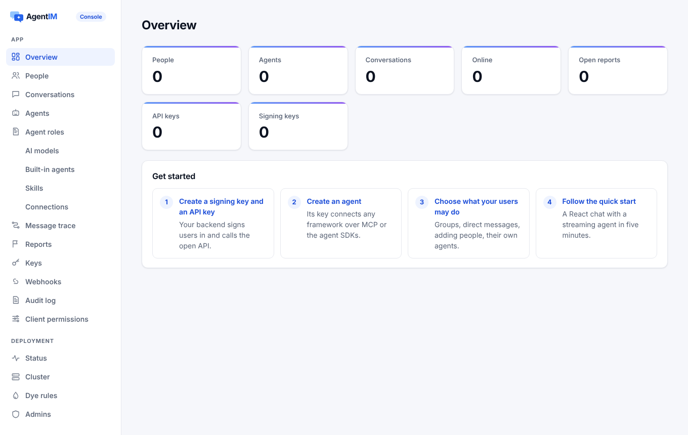
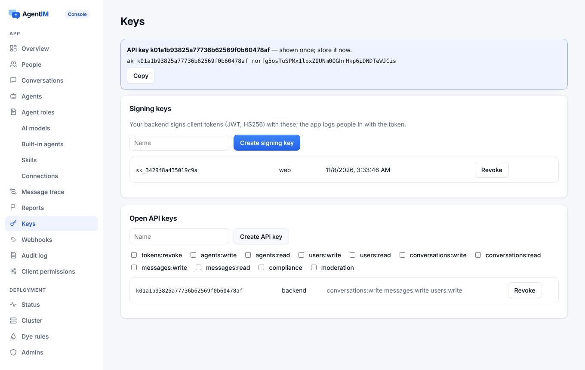
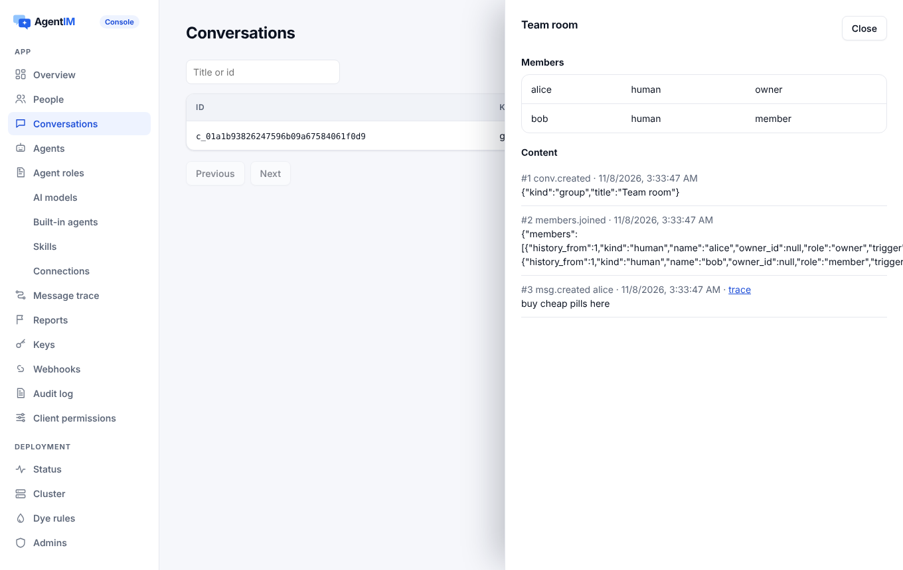
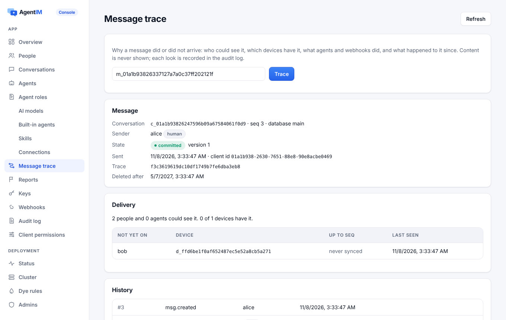
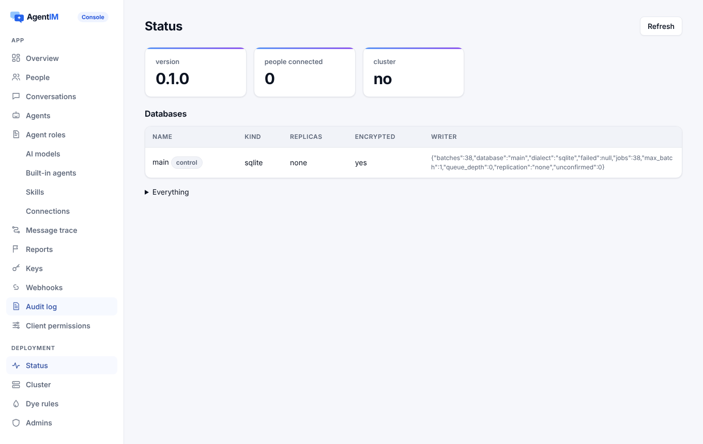
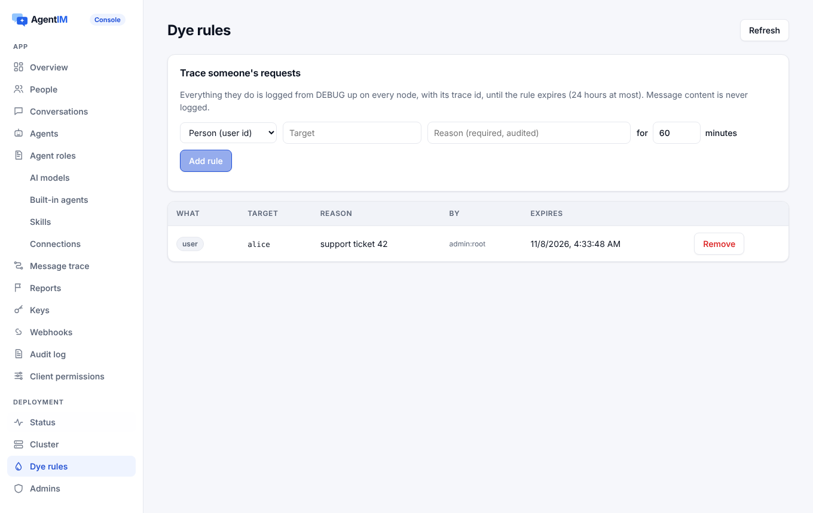
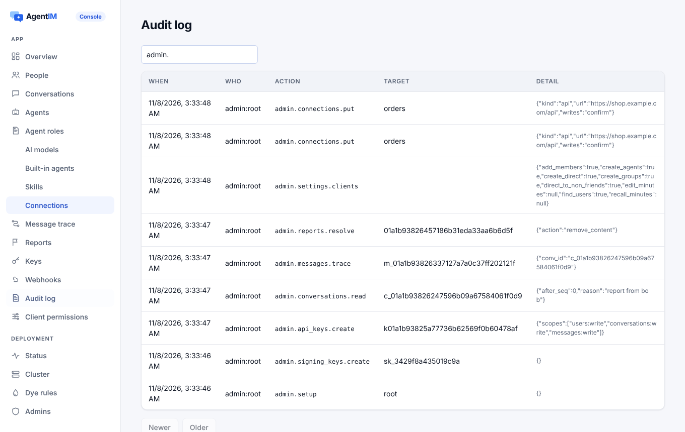

# 开发者体验

让 AgentIM 容易上手的一切：安装和第一次运行、发布和签名、客户端 SDK 包、控制台、文档站和示例。

代码：`deploy/`（Dockerfile、安装脚本、Compose、Helm、发布检查）、`.github/workflows/`（`release.yml`、`sdk-packages.yml`、`sdk-release.yml`、`deps.yml`、`site.yml`、`server.yml`、`scale.yml`）、`server/console/`、`server/demo/`、`site/`、`examples/`、`sdk/version.sh`、`CHANGELOG.md`。

## 1. 用途

| 目标 | 标准 |
|---|---|
| 从下载到发出第一条消息 | 少于 5 分钟 |
| 从注册到第一个 Agent 回复 | 少于 10 分钟 |
| 按文档把聊天和助手嵌进 Next.js 应用 | 少于 30 分钟 |
| 每个示例一条命令跑起来 | 是（从启动到第一个 Agent 回复 1.7 秒） |

## 2. 功能点

| 编号 | 功能 | 行为 |
|---|---|---|
| DX-01 | 预编译程序 | Linux x86_64 和 aarch64（静态 musl）、macOS x86_64 和 arm64、Windows x86_64，每个附 SHA-256。固定 Rust 版本、不用缓存、`--locked`，嵌入控制台 |
| DX-02 | 一条命令安装 | `install.sh` 和 `install.ps1` 装到用户目录，不需要 root。校验 SHA-256（没有校验工具就不装），`AGENTIM_VERSION` 装指定版本，原子地替换程序 |
| DX-03 | 签名和来源证明 | 每个发布文件都有 Sigstore 签名包和 GitHub 构建来源证明。第三方 Action 都固定到提交 |
| DX-04 | 镜像和 Helm | `ghcr.io/<owner>/agentim`，amd64 和 arm64，用同一个静态程序，用户 10001，带 SBOM，有签名。Helm Chart 以同版本的 OCI 包发布 |
| DX-05 | 第一次运行 | 在空目录里运行 `agentim`：建 `agentim.db` 和 `agentim.db.key`（0600；别人能读就拒绝启动），打印地址和一次性的控制台初始化链接。`agentim --demo` 带演示用户和演示 Agent 启动 |
| DX-06 | 版本和更新日志 | 语义化版本。程序、Chart、标签、`CHANGELOG.md` 里的小节必须一致，否则发布一开始就停 |
| DX-07 | 依赖检查 | `cargo-deny`（漏洞、只允许宽松许可证、只从 crates.io）和 npm audit，每次发布前跑，也可以手动跑 |
| DX-08 | 客户端 SDK 包 | 所有包一个版本号，打 `sdk-v*` 标签时先构建和测试全部包再发布。手动运行时同样构建和测试，只是不上传。支持 OIDC 发布的注册表（npm、NuGet、pub.dev）不存长期密钥 |
| DX-09 | Swift 包的仓库 | SwiftPM 要求 `Package.swift` 在仓库根目录，所以发布时把包提交到 [`agentim-swift`](https://github.com/wmkrfjnwvb-svg/agentim-swift) 并打标签；XCFramework 和它的 checksum 挂在 Release 上 |
| DX-10 | 控制台 | 嵌在程序里的 React 应用，地址 `/console`（[access](access.md)）。页面：概览、密钥、人员、Agent、助手、模型服务、连接和审批规则、角色、Skills、会话、举报、Webhook、审计、设置、消息轨迹、染色规则、集群和数据库、管理员 |
| DX-11 | 演示 | 一个网页应用（React，基于浏览器 SDK 和组件），`--demo` 时嵌入，带演示用户和脚本化的 Agent |
| DX-12 | 文档站 | `site/`（Astro + Starlight）：首页、云服务、价格和性能页，中英文两版（`/zh/`），产品界面用 React 组件按页面语言实时展示（可切换的会话、话题、点击跳到原消息的置顶、Agent 卡片和审批）；文档按能力组织（IM 功能、AI Agent、UI 组件、SDK、部署和运维、安全、参考），每个功能页用同一模板（能做什么、实时演示或截图、怎么工作、各平台代码、哪些端支持、限制和错误），文档首页是能力地图，中文文档在 `/zh/docs/`（未翻译的页面显示英文），右上角切换语言；参考由代码生成。有端点、协议消息、错误、规则或 SDK 方法没有页面，CI 就失败 |
| DX-13 | 示例 | 三个应用，各一条命令，不需要模型 Key：售后助手、顾问和 AI 助理、多 Agent 任务房间。另有 OpenAI Agents SDK、Claude Agent SDK、LangGraph 的模板 |
| DX-14 | 谁都能跑的压测 | `server/bench/single-node.sh` 和 `server/bench/cluster.sh` 打印 README 里的表 |

## 3. 设计

### 3.1 发布

- **打 `v*` 标签时**，`release.yml` 构建五个目标，在 Linux、macOS（Intel 版也用 Rosetta 跑）、Windows 上真实安装并运行：
  1. 从本地下载地址安装；
  2. `--version`；
  3. 在空目录里启动；
  4. 检查 `/readyz`；
  5. 用开放 API 发第一条消息并读回（`deploy/smoke/first_message.py`）；
  6. 再装一次（升级）；
  7. 拒绝被改坏的压缩包。
- **镜像**装同一个静态程序，推送前每种架构各启动一次（arm64 在 QEMU 里）。
- **发布任何东西之前**，先跑完整测试套件（`server.yml`）。手动运行时整个发布流程空跑一遍，只是不上传。

### 3.2 客户端 SDK 包

| 包 | 内容 | 怎么测 |
|---|---|---|
| 原生库 `libagentim_client` | Linux x64/arm64（glibc 2.28）、macOS x64/arm64、Windows x64 | 各平台跑 C ABI 测试 |
| XCFramework | iOS 真机和模拟器、macOS；头文件和 module map | 在 macOS 上跑 Swift 场景；为 iOS 模拟器编译 |
| NuGet `AgentIM.Client` | net8.0、netstandard2.1，按运行时放原生库 | 在三种系统上装进新项目，连真实服务端发一条消息 |
| npm（浏览器、React、React Native UI） | 检查 `npm pack` 的内容 | 单元测试和端到端测试 |
| npm `@agentimhq/client-react-native` | C++ TurboModule（JSI），自动链接；Android 四种 ABI 和 iOS 的原生核心 | 测试 App 在 Android 模拟器和 iOS 模拟器里跑 |
| Unity `com.agentim.client` | UPM 包：同一份 C#，Android、iOS、macOS、Windows 的插件和 WebGL 的 `.jslib`；固定的 `.meta` GUID | 包检查；WebGL 桥在 Node 里测 |
| Android `com.agentim:client` | 四种 ABI、16 KB 页的 AAR，POM、源码包和 javadoc；Central Portal 的上传包 | 依赖这个 AAR 的应用在 Android 模拟器里跑 |
| Flutter 和 Dart `agentim_client` | Dart FFI，构建钩子下载并核对 12 个预编译库（在本仓库里则用 cargo 构建） | 三种系统上的 Dart VM、一个 Linux Flutter 应用、Android 模拟器 |

### 3.3 文档站

- 手写的页面在 `site/src/content/docs/`。
- 参考由 `site/scripts/reference.mjs`、`sdk.mjs`、`add-docs.mjs` 从代码生成：
  - 开放 API（来自 `/v1/openapi.json`）；
  - 客户端协议（来自 `protocol.rs`）；
  - MCP 工具、配置、错误和业务规则；
  - 每个 SDK 的公开接口。
- `site/scripts/complete.mjs` 在有东西缺页时让构建失败。
- `site.yml` 每次改动都构建，Cloudflare 从仓库构建。

### 3.4 控制台截图

由 `server/ci/console_smoke.mjs` 对真实服务端截取。

| 概览 | 人员和密钥 | 连接和审批规则 |
|---|---|---|
|  |  |  |
| **一个会话（看内容要写原因）** | **消息轨迹** | **部署状态** |
|  |  |  |
| **染色规则** | **审计日志** | |
|  |  | |

## 4. 接口

- 命令：`agentim`（第一次运行）、`agentim --demo`、`agentim admin …`、`agentim cluster …`、`agentim verify`、`agentim encryption …`、`agentim api-key|signing-key|admin-key|token …`。
- 工作流：
  - `release.yml`（`v*`）；
  - `sdk-packages.yml`（`sdk-v*`、手动）；
  - `sdk-release.yml`（`sdk-v*`）；
  - `deps.yml`、`server.yml`（每次发布、手动），`site.yml`、`scale.yml`（手动）。推送和 PR 不再触发 CI。

## 5. 规则和错误

第一次运行在这些情况下拒绝启动：
- 密钥文件别人能读；
- 主密钥不对；
- 数据库的持久化配置不安全。

每次拒绝都说明该怎么做。

## 6. 测试

| 功能点 | 测试 |
|---|---|
| DX-01–DX-04, DX-06 | `.github/workflows/release.yml` run by hand (no upload); `deploy/release/` version checks; `deploy/smoke/first_message.py` |
| DX-05 | `server/crates/agentim/tests/cli.rs`: `the_first_run_needs_nothing`, `the_demo_refuses_a_public_address`; `encryption.rs`: `a_single_sqlite_database_gets_a_generated_key`, `the_master_key_is_checked` |
| DX-07 | `.github/workflows/deps.yml` |
| DX-08, DX-09 | `.github/workflows/sdk-packages.yml` (every package built, installed and run); `sdk/version.sh`; `sdk/check-npm-pack.mjs`; `sdk/client-swift/test-xcframework.sh`; `sdk/client-dotnet/test-package.sh`; `sdk/client-flutter/test-package.sh`; `sdk/client-react-native/test-app.sh` |
| DX-10 | `server/ci/console_smoke.mjs` (31 checks in a browser against a real server, including the approval-rule editor and assistant switches); `admin_api.rs` |
| DX-11 | `http.rs`: `demo_endpoints_work_in_the_demo`; `server/ci/ui_smoke.mjs` |
| DX-12 | `site/scripts/complete.mjs` in `site.yml` |
| DX-13 | `examples/test/e2e.mjs` (all three apps end to end in a browser) |
| DX-14 | `server/bench/` |

## 7. 限制和下一步

- 客户端 SDK 还没发到各个注册表：要先建好账号、命名空间和签名密钥。
- 没做：
  - macOS 公证和 Windows Authenticode，需要付费证书；
  - Unity 编辑器里的测试，需要许可；
  - 真机测试。
- 客户端权限以外的大多数应用设置在控制台里是只读的。
