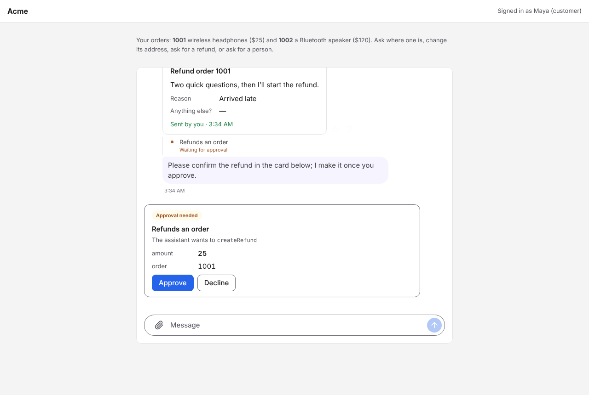
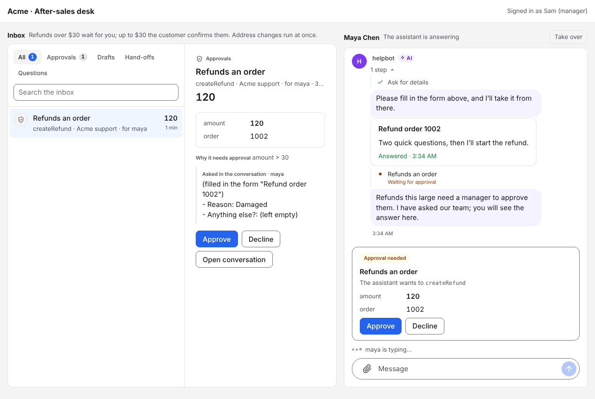
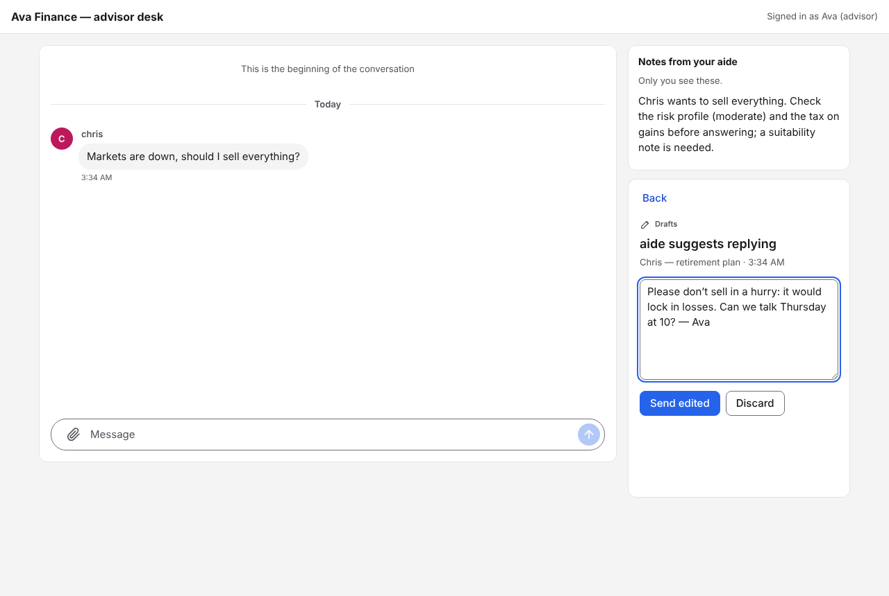
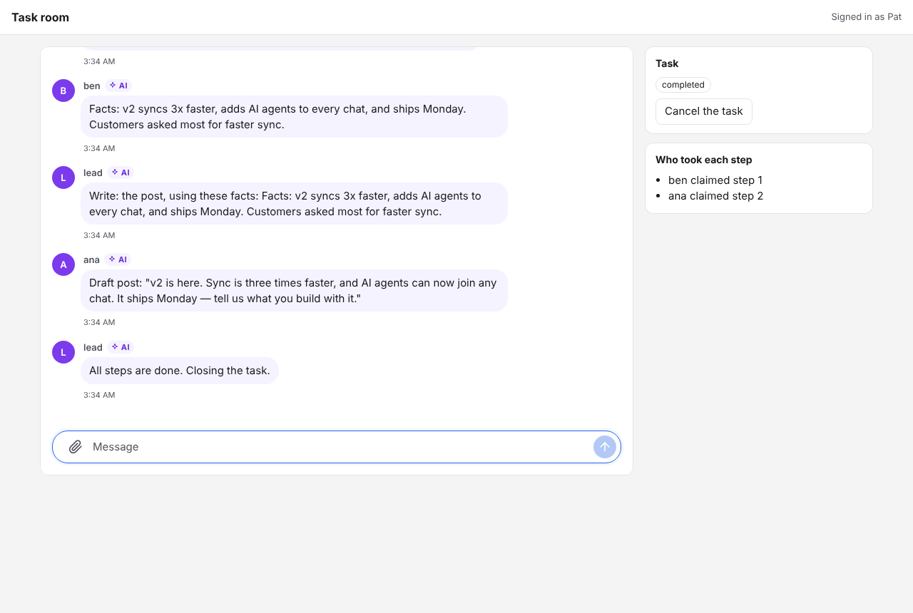

# AgentIM examples

Three small apps, each one command (docs/en/design/developer-experience.md). They run with a **scripted model**, so you need no account anywhere. Set `ANTHROPIC_API_KEY` to use Claude instead (`ANTHROPIC_MODEL` picks the model; the default is `claude-sonnet-5-5`).

| | Command | What it shows |
|---|---|---|
| **After-sales assistant** | `npm run aftersales` | A customer asks the shop's assistant about an order. The assistant runs inside the server ([built-in assistants](../docs/en/design/assistants.md)) and calls the shop's orders API: it shows the order as a data card, asks why with a form before a refund, and shows its steps. Address changes run at once; a refund up to $30 the customer confirms in the chat; above that the manager approves it in the inbox (Sam, `/desk`). Asked for a person, it hands over to Sam, who hands back from the inbox ([chat components](../docs/en/design/chat-components.md)) |
| **Advisor and client with an AI aide** | `npm run advisor` | Chris writes to a financial advisor, Ava. Ava's aide drafts every reply; Chris sees nothing until Ava sends it from the inbox, edited or not ([approval rules](../docs/en/design/agents.md)). The aide also passes Ava private notes that only Ava sees |
| **Multi-agent task room** | `npm run tasks` | A lead agent splits a task into steps and posts each as a request. Two workers race to claim it (exactly one wins), report back, and the lead closes the task. The person can step in or cancel at any time |

| After-sales: the customer | After-sales: the manager's desk |
|---|---|
|  |  |
| **Advisor with an AI aide** | **Multi-agent task room** |
|  |  |

Each one starts its own `agentim` server with a fresh database, creates the people and agents through the open API (what your backend does), signs each person a token with a signing key, and serves the pages on `http://localhost:3000` (`PORT` changes it; the server takes the next port).

## Run

```sh
cd server && cargo build && cd ..        # or put a released agentim on PATH, or set AGENTIM_BIN
cd examples && npm install
npm run aftersales
```

Until the SDKs are published to npm, `npm install` links them from `../sdk`. Build them first: `sdk/client-web` (with its WebAssembly core) and `sdk/react` (`npm run build` in each).

## How the pieces fit

- `lib/kit.mjs` is "your backend": it starts `agentim`, creates an API key and a signing key with the CLI, creates users with the [server SDK](../sdk/node), and signs tokens (`createUserToken`). The pages get a token from `/api/session`.
- The after-sales assistant needs no agent process: the backend sets it up once with the admin API (a model service, the orders API as a connection with its approval rules, a role in Markdown). `lib/shop.mjs` is the shop: its orders API (OpenAPI) and a scripted model in the OpenAI format.
- The other agents use the [Node agent SDK](../sdk/agent-node): `onMessage`, `ctx.reply()`, `send` with `to_user` (a private note), `claim`, `progress`, `updateTask`.
- The pages use the [React components](../sdk/react) (`<AgentIM>`, `<Chat>`) on the [web client](../sdk/client-web). Cards, forms, steps and approval cards come with `<Chat>`; the desks use `<Inbox>`. The few extra controls (take over, notes, task state) call the client protocol with `client.call(…)`.

## Your own agent framework

`agents/` has templates that connect an agent built with another framework through the agent SDK. They are not run in CI, because they need a model key:

- `claude-agent-sdk.mjs`: the Claude Agent SDK. The agent's skills and MCP servers from AgentIM are written to disk where it looks (`files` option).
- `openai_agents.py`: the OpenAI Agents SDK. The MCP servers go in as `MCPServerStreamableHttp`.
- `langgraph_agent.py`: LangGraph. Each conversation is a LangGraph thread.

## Test

`npm test` runs all three examples with the scripted model and walks their main flows in Chromium (Playwright). It also checks that the first agent reply arrives within 30 seconds of starting.
