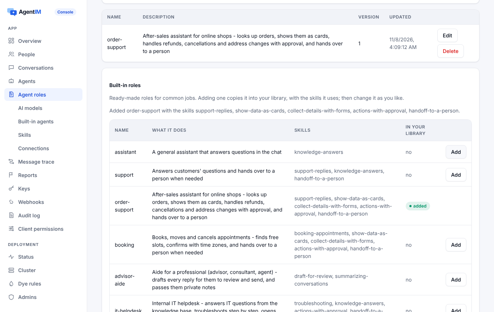

import { Tabs, TabItem } from '@astrojs/starlight/components';
import Capabilities from '../../../../components/docs/Capabilities.astro';
import Support from '../../../../components/docs/Support.astro';
import ProductShowcase from '../../../../components/ProductShowcase';

<Capabilities>
- A **role** is the agent's job in Markdown: who it is, what it may do, what it uses
- **Skills** teach habits it loads only when needed: show data as cards, ask with a form, hand off to a person…
- 12 ready roles (order support, booking, IT and HR helpdesks, sales…) and 14 ready Skills to copy and change
- The same formats as Claude Code agents and Agent Skills: files move both ways
- A role names its [connections](/docs/ai/connections/), so the agent can act in your systems
- Works for agents the server runs and for agents you run with the Node or Python SDK
- Change a role and every agent using it is updated at once
</Capabilities>

## See it

The console's **Agent roles** page: add a ready role and its Skills come with it.



In the chat, Nova runs the built-in `order-support` role. Its Skills make it show the order as a card, list its steps and ask before the refund; the panel on the right is what it did in the shop's systems.

<ProductShowcase client:visible lang="en" only="agent" />

## How it works

**A role** is a Markdown file: a header with `name` and `description` (and optionally the Skills and connections it uses), then the instructions.

```markdown
---
name: order-support
description: After-sales assistant for online shops
skills: [support-replies, show-data-as-cards, collect-details-with-forms,
         actions-with-approval, handoff-to-a-person]
apis: [orders]      # an OpenAPI connection
mcp: [ups]          # an MCP server
---
You are the after-sales assistant of an online shop.
Find the order first and show it as a data card.
Before a refund, ask why with a short form…
```

- An agent has one role at a time (`PUT /admin/v1/app/agents/{id}/role`). Changing the role tells the agent's connections `config.updated`, so running agents pick it up without a restart.
- A role an agent uses can't be deleted (`409 role.in_use`). Claude Code's `agents/*.md` files load as they are.

**A Skill** is a folder in the Agent Skills format: a `SKILL.md` with `name` and `description`, and reference files.

- The agent sees every Skill's name and description; it loads the rest (`load_skill`, `read_skill_file`) only when the job needs it, so many Skills cost little context.
- Skills are instructions only: scripts are never run.
- A Skill a role names can't be deleted (`409 skill.in_use`).

**The built-in library.** Adding a role copies it into your library with the Skills it uses that you don't have yet; then change your copy. `POST` with `{"replace": true}` restores the shipped text.

| Roles | Skills |
|---|---|
| `assistant`, `support`, `order-support`, `booking`, `advisor-aide`, `it-helpdesk`, `hr-helpdesk`, `sales`, `notes`, `translator`, `moderator`, `task-lead` | `support-replies`, `handoff-to-a-person`, `actions-with-approval`, `show-data-as-cards`, `collect-details-with-forms`, `knowledge-answers`, `booking-appointments`, `draft-for-review`, `troubleshooting`, `summarizing-conversations`, `meeting-notes`, `translation`, `content-moderation`, `task-coordination` |

## Use it

<Tabs syncKey="agent">
<TabItem label="Console">
1. **Agent roles** → *Built-in roles* → add `order-support` (its Skills come with it), or write your own.
2. **Built-in agents** → enable it with a model service and a model, or give the role to an agent you run yourself.
3. Edit the role's Markdown or a Skill's `SKILL.md` any time; agents using them update at once.
</TabItem>
<TabItem label="Admin API">
```bash
# Add a built-in role with its Skills
curl -X POST "$AGENTIM/admin/v1/app/library/roles/order-support" -H "Authorization: Bearer $ADMIN_KEY"
# {"role": "order-support", "skills_added": ["support-replies", "show-data-as-cards", ...]}

# Your own Skill and role
curl -X PUT "$AGENTIM/admin/v1/app/skills/refunds" -H "Authorization: Bearer $ADMIN_KEY" \
  -H "content-type: text/markdown" --data-binary @skills/refunds/SKILL.md
curl -X PUT "$AGENTIM/admin/v1/app/roles/support" -H "Authorization: Bearer $ADMIN_KEY" \
  -H "content-type: text/markdown" --data-binary @roles/support.md

# Give the role to an agent
curl -X PUT "$AGENTIM/admin/v1/app/agents/nova/role" -H "Authorization: Bearer $ADMIN_KEY" -H "content-type: application/json" -d '{"role": "support"}'
```
</TabItem>
<TabItem label="Node agent">
Your own agent gets its role's Skills and connections in `agent.config`, and can write them where Claude Code and the Claude Agent SDK read them:

```js
const agent = new Agent({ url, key, files: { dir: './workdir' } });
// writes .claude/skills/<name>/SKILL.md, .mcp.json and .agentim/apis/*.openapi.json
```
</TabItem>
<TabItem label="Python agent">
```python
agent = Agent(url, key, files={"dir": "./workdir"})
# or once: await agent.write_files(dir="./workdir")
```
</TabItem>
</Tabs>

## Where it works

Roles and Skills are set on the server and apply to every client: people see the agent's replies, cards and forms in any SDK. The agent side works for agents the server runs ([built-in agents](/docs/guides/built-in-agents/)) and for your own agents with the [Node and Python Agent SDKs](/docs/agent-sdks/#skills-and-mcp-servers-on-disk).

<Support sdk={['Web', 'React Native', 'iOS', 'Android', 'Flutter', '.NET']} ui={['React', 'React Native UI']} note="Cards, forms and steps the Skills produce are drawn by the React and React Native components." />

## Limits and errors

| Limit | Value |
|---|---|
| Reference files per Skill | 20, text, up to 512 KB each |
| Roles per agent | 1 |
| Deleting a role or Skill in use | `409 role.in_use`, `409 skill.in_use` |

Roles and Skills are written by owners and developers; moderators read them. See the [admin API](/docs/reference/admin-api/).

## Related

[Connect your systems](/docs/ai/connections/) · [Built-in agents](/docs/guides/built-in-agents/) · [Human approval](/docs/concepts/approvals/) · [Cards, forms and steps](/docs/guides/chat-components/) · [Agents as members](/docs/concepts/agents/)
