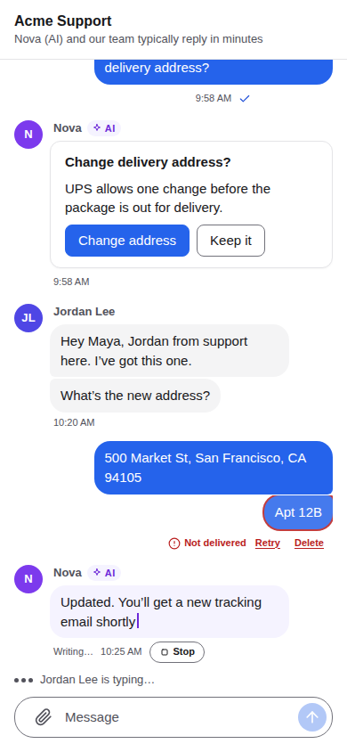

import { Tabs, TabItem } from '@astrojs/starlight/components';
import Capabilities from '../../../../components/docs/Capabilities.astro';
import Support from '../../../../components/docs/Support.astro';

<Capabilities>
- Every device gets every event exactly once and in order, after any disconnect
- An offline queue: sends, edits, read marks and card answers go out after the network or the app comes back
- An encrypted local cache: the list and recent messages show at once, also offline
- Edits and sends show immediately and are confirmed by the server
- Read on one device, read everywhere; unread counts and mentions kept by the server
- Mute a conversation on every device, for a while or for good
- History for new devices and new members, with clear limits
- Reconnects by itself with backoff, at once when the network returns
</Capabilities>

## See it

The same conversation on the web and on a phone: what you read on one is read on the other.



## Push is a hint, sync is the truth

The server pushes each event to the devices that are online. Pushes can be lost: a phone sleeps, a network drops, a slow client's queue fills up. Correctness never depends on them.

- **The server keeps each device's position** in each conversation: the last `seq` the device acknowledged. A device does not say where to start. It asks to sync, and the server continues from what it acknowledged.
- **A push is only delivered if it continues exactly** from what this connection already received. Otherwise the device gets `resync` and pulls the rest with its next `sync`. So an event is never both pushed and synced, and never arrives out of order.
- **Acknowledging only moves forward.** A device cannot acknowledge something it was not sent, so a forged acknowledgement can only make it miss messages, never receive more.
- **Flow control:** at most 200 events per conversation per batch, and at most 1,000 unacknowledged per conversation, until the device acknowledges.

The client SDKs do all of this. Your app sees three observable things: the connection, the conversation list, and each conversation's messages.

## What the client SDK keeps

| | |
|---|---|
| **Offline queue** | Sends, edits, recalls, read marks, feedback and card answers are stored before they are sent. They go out once and in order when the connection allows, also after the app restarts. A message is `sending` until the server has it and `failed` only when the server refuses it by its rules (not a member, blocked, …). Network trouble, overload and rate limits are retried, never turned into failures. |
| **Local cache** | Conversations and messages, encrypted on disk (SQLite on devices, IndexedDB in browsers). The conversation list and recent messages show instantly on start, also offline. |
| **Shown at once** | What the app shows is the server's copy with the queue laid over it. An edit shows its new text immediately and is marked `pending` until confirmed; a refused operation simply disappears. |
| **Reconnection** | Exponential backoff with jitter. After two minutes offline it retries about once a minute (`suspended`). It reconnects at once when the network changes or the app returns to the foreground, and waits as long as the server asks after `rate_limited` or `goaway`. |

## History

### New devices

A new device, a reinstall or a cleared cache starts small. It gets the conversation list first, then the most recent 30 messages of each conversation from the last 90 days. Scrolling up loads older pages from the server (50 at a time) and keeps them in the cache. `jumpTo(seq)` and "jump to first unread" load a page around a message.

`hasOlder` becomes false when there is nothing earlier to load, with the reason:

| `olderEnd` | Meaning |
|---|---|
| `start` | The beginning of the conversation |
| `visible_from` | The beginning of what this member may see (they joined later) |
| `retention` | Older events were deleted by the retention period |
| `disabled` | The server does not allow paging back |

### History for new members

People added to a group see the most recent 30 messages from the last 30 days by default. Whoever adds them can choose a different number (`history`, 0 for none, up to 200), and everyone in the conversation sees how much was shared. Members added when the conversation is created see it from the start. Agents see nothing before they joined unless they are given history ([agents](/docs/concepts/agents/)).

The visible start is fixed when someone joins. Changing the server's settings later does not change what existing members can see.

### Server settings

```toml
[sync]
batch_size = 200       # events per conversation per batch
max_unacked = 1000     # unacknowledged events per conversation
max_gap = 10000        # a device further behind starts over like a new one
device_ttl_days = 30   # a device that acknowledged nothing for this long is forgotten
window_days = 90       # how far back a new device syncs (at most 90)
max_messages = 30      # messages per conversation for a new device
member_messages = 30   # history for a new member
member_days = 30
share_max = 200        # the most history someone adding a member may share

[retention]
days = 180             # 0 keeps everything
```

Every option is listed in the [configuration reference](/docs/operations/configuration/).

## Read state, unread counts and muting

- `read` marks a conversation read up to a `seq` on all of the user's devices. Sending a message marks everything before it read.
- The server counts unread messages and mentions per conversation. Edits, recalls of old messages and system events don't count.
- With `read_silences_others` (on by default), a message already read on one device doesn't raise the unread count or notify on the others.
- Muting (`none`, `all` or `mentions`, optionally until a time) is stored on the server and applies to all devices. A muted conversation still syncs and counts unread messages. It just doesn't notify.

## Retention

Events older than `retention.days` are deleted from the start of each log, never from the middle. A device that was away longer than that starts at the oldest event still kept and shows "Earlier messages are no longer available".

## Use it

<Tabs syncKey="platform">
<TabItem label="Web">
```ts
client.connection.subscribe((c) => showStatus(c.state));      // connected, disconnected, suspended…
const view = client.messages(convId);
view.subscribe((messages) => render(messages));                // sending, failed, pending edits included
if (view.hasOlder) await view.loadOlder();                      // 50 at a time
view.jumpTo(seq);                                               // a page around a message
await client.read(convId);                                      // read on every device
await client.call('set_mute', { conv_id: convId, mode: 'mentions' });
```
</TabItem>
<TabItem label="React">
```tsx
<AgentIM client={client}>
  <ConnectionBanner />           {/* offline, reconnecting… */}
  <Chat convId={convId} />       {/* unread divider, jump to latest, retry a failed send */}
</AgentIM>
```
</TabItem>
<TabItem label="iOS">
```swift
let view = client.messages(convId)
try await view.loadOlder()
client.setNetwork(online: false)      // from NWPathMonitor
client.setForeground(true)            // from the app's scene phase
try await client.read(convId)
```
</TabItem>
<TabItem label="Android">
```kotlin
val view = client.messages(convId)
view.loadOlder()
client.setNetwork(online = false)     // from ConnectivityManager
client.setForeground(true)            // from the process lifecycle
client.read(convId)
```
</TabItem>
</Tabs>

## Where it works

<Support sdk={['Web', 'React Native', 'iOS', 'Android', 'Flutter', '.NET']} ui={['React', 'React Native UI']} note="Every client SDK runs the same Rust core, so the queue, cache and retry rules are identical everywhere." />

## Related

[Conversations and messages](/docs/concepts/conversations/) · [Devices and login](/docs/concepts/devices-and-login/) · [Client protocol](/docs/reference/client-protocol/) · [Configuration](/docs/operations/configuration/)
