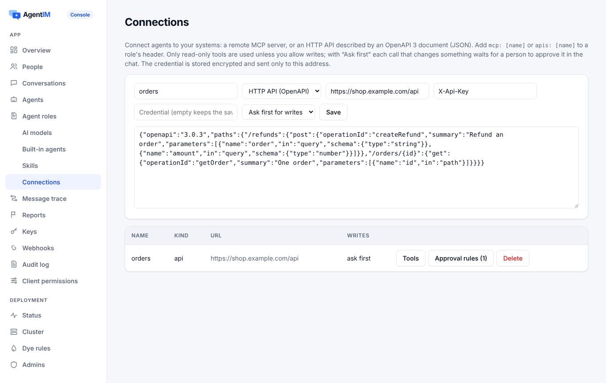

import { Tabs, TabItem } from '@astrojs/starlight/components';
import Capabilities from '../../../../../components/docs/Capabilities.astro';
import AgentMap from '../../../../../components/site/AgentMap.astro';

<Capabilities>
- 导入 **OpenAPI 3** 文档：每个接口都变成 Agent 能调用的工具
- 添加远程 **MCP 服务**（Streamable HTTP）：它的工具就是 Agent 的工具
- 读操作直接执行；**写操作**可以关闭、**先问**或允许
- 按工具和金额设置**审批规则**：超过 30 美元的退款等客服主管批准
- 批准后的调用只执行一次，参数就是审批人看到的那些
- 凭据加密保存，只发往这个连接自己的地址
- 角色里写上连接名；内置 Agent 和你自己的 Agent 都能用
- 用户用自己账号授权的应用（Slack、Salesforce、Gmail）：即将推出
</Capabilities>

## 看一眼

<AgentMap lang="zh" />

控制台的**连接**页面：一个从 OpenAPI 文档导入的订单接口，写操作设为"先问"，带一条审批规则。



## 怎么工作

| | OpenAPI | MCP |
|---|---|---|
| 你提供 | OpenAPI 3 文档（JSON）、基础 URL、认证头 | 服务地址（Streamable HTTP）、认证头 |
| 工具 | 每个接口，命名为 `{connection}__{operationId}`，带它的说明和参数 | 服务列出的工具（保存前必须能列出） |
| 读操作 | `GET`、`HEAD` | 标记为只读（`readOnlyHint`）的工具 |
| 写操作 | `POST`、`PUT`、`PATCH`、`DELETE` | 其余所有工具 |

**写操作。** 连接的 `writes` 可以是 `read_only`（只用读操作）、`confirm`（每次写都先问）或 `allow`。

设为 `confirm` 时，写操作不会直接执行：Agent 会请它正在回答的人批准，显示工具和参数，但从不显示凭据。Agent 会告诉对方它在等待批准；不会卡住，重启也不会丢。批准后，服务端先确认连接仍允许写、工具仍在角色里，然后用保存的参数**只执行一次**。接口调用带 `Idempotency-Key: <请求 id>`。拒绝会连同原因交还给 Agent；过期（一小时）或取消就不会执行。见[人工审批](/zh/docs/concepts/approvals/)。

**审批规则**可以更细：每个连接最多 20 条，按顺序匹配第一条。每条有 `tool`，可选 `amount_field` 和 `over`（金额缺失或不是数字按超过处理）、`approvers`，或者 `confirm: false` 表示这个写操作直接执行。

**安全。** 凭据加密保存，从不列出或写入审计，只发往连接自己的主机。私有地址和回环地址会被拒绝（测试和内网部署可以设置 `[ai] private_addresses = true`）。

## 怎么用

<Tabs syncKey="agent">
<TabItem label="控制台">
1. **连接** → 填名字，选 *HTTP API（OpenAPI）* 或 *MCP 服务*，填地址、认证头、凭据和写操作方式。
2. **工具**显示 Agent 会拿到哪些工具；**审批规则**按工具和金额添加规则。
3. 在角色头部加上 `apis: [orders]` 或 `mcp: [ups]`。
</TabItem>
<TabItem label="管理 API">
```bash
# 从 OpenAPI 文档接入一个 HTTP 接口；写操作先问，超过 30 的退款走一条规则
curl -X PUT "$AGENTIM/admin/v1/app/connections/orders" -H "Authorization: Bearer $ADMIN_KEY" \
  -H "content-type: application/json" -d @- <<'JSON'
{"kind": "api", "url": "https://shop.example.com/api", "auth_header": "X-Api-Key", "secret": "…",
 "spec": { "openapi": "3.0.3", "paths": { … } }, "writes": "confirm",
 "approvals": [{"tool": "createRefund", "amount_field": "amount", "over": 30}]}
JSON

# 一个远程 MCP 服务
curl -X PUT "$AGENTIM/admin/v1/app/connections/ups" -H "Authorization: Bearer $ADMIN_KEY" \
  -H "content-type: application/json" -d '{"kind": "mcp", "url": "https://mcp.example.com/ups", "auth_header": "Authorization", "secret": "Bearer …", "writes": "read_only"}'

curl "$AGENTIM/admin/v1/app/connections/orders/tools" -H "Authorization: Bearer $ADMIN_KEY"
```
</TabItem>
<TabItem label="角色">
```markdown
---
name: order-support
description: After-sales assistant for online shops
apis: [orders]
mcp: [ups]
---
Look up the order before you answer. Refunds go through createRefund.
```
</TabItem>
<TabItem label="你自己的 Agent">
用 Node 或 Python SDK 运行的 Agent 会在 `agent.config` 里拿到角色的连接和认证头。对 Claude Code 和 Claude Agent SDK，SDK 会把它们写到 `.mcp.json` 和 `.agentim/apis/<name>.openapi.json`：

```js
const agent = new Agent({ url, key, files: { dir: './workdir' } });
agent.mcpServers();   // [{ name, url, headers }]，给其他框架用
```
</TabItem>
</Tabs>

## 限制和错误

| | |
|---|---|
| 每个应用的连接数 | 20（`429 connection.limit`） |
| 每个连接的审批规则 | 20 |
| 审批请求过期时间 | 1 小时 |
| 删除角色正在用的连接 | `409 connection.in_use` |

连接由所有者和开发者编写。完整请求见[管理 API](/zh/docs/reference/admin-api/)。

## 相关

[角色和 Skills](/zh/docs/ai/roles-and-skills/) · [人工审批](/zh/docs/concepts/approvals/) · [安全护栏](/zh/docs/concepts/guardrails/) · [内置 Agent](/zh/docs/guides/built-in-agents/) · [Agent SDK](/zh/docs/agent-sdks/)
