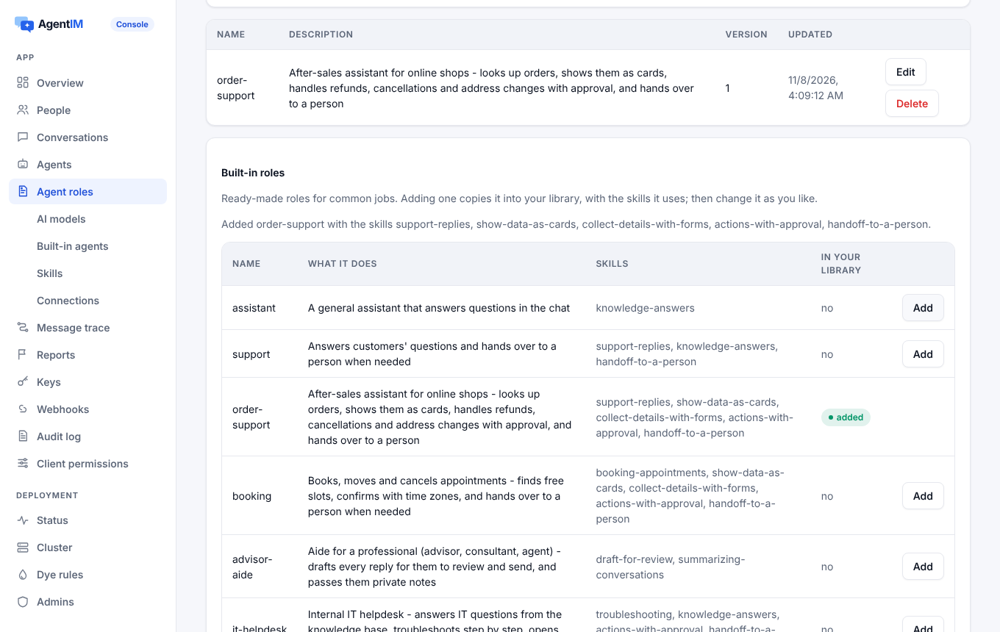

import { Tabs, TabItem } from '@astrojs/starlight/components';
import Capabilities from '../../../../../components/docs/Capabilities.astro';
import Support from '../../../../../components/docs/Support.astro';
import ProductShowcase from '../../../../../components/ProductShowcase';

<Capabilities>
- **角色**用 Markdown 写 Agent 的工作：它是谁、能做什么、用哪些工具
- **Skills** 教它按需加载的做事方法：把数据显示成卡片、用表单收集信息、转人工……
- 12 个现成角色（售后、预约、IT 和 HR 服务台、销售……）和 14 个现成 Skills，可以复制后修改
- 格式和 Claude Code 的 Agent、Agent Skills 相同：文件可以双向搬
- 角色里写上它用的[连接](/zh/docs/ai/connections/)，Agent 就能在你的系统里办事
- 服务端运行的 Agent 和你用 Node、Python SDK 自己运行的 Agent 都适用
- 改一次角色，所有用它的 Agent 立刻更新
</Capabilities>

## 看一眼

控制台的 **Agent 角色**页面：添加一个现成角色，它用到的 Skills 会一起加进来。



在聊天里，Nova 运行的是内置的 `order-support` 角色。它的 Skills 让它把订单显示成卡片、列出办事步骤、退款前先请人批准；右边是它在商店系统里做了什么。

<ProductShowcase client:visible lang="zh" only="agent" />

## 怎么工作

**角色**是一个 Markdown 文件：头部写 `name` 和 `description`（还可以写它用的 Skills 和连接），下面是指令。

```markdown
---
name: order-support
description: After-sales assistant for online shops
skills: [support-replies, show-data-as-cards, collect-details-with-forms,
         actions-with-approval, handoff-to-a-person]
apis: [orders]      # 一个 OpenAPI 连接
mcp: [ups]          # 一个 MCP 服务
---
You are the after-sales assistant of an online shop.
Find the order first and show it as a data card.
Before a refund, ask why with a short form…
```

- 一个 Agent 同一时间只有一个角色（`PUT /admin/v1/app/agents/{id}/role`）。换角色会给 Agent 的连接发 `config.updated`，正在运行的 Agent 不用重启就能用上。
- 正在被使用的角色不能删除（`409 role.in_use`）。Claude Code 的 `agents/*.md` 文件可以直接导入。

**Skill** 是一个 Agent Skills 格式的文件夹：一个带 `name` 和 `description` 的 `SKILL.md`，加上参考文件。

- Agent 能看到每个 Skill 的名字和说明；只有工作需要时才加载其余内容（`load_skill`、`read_skill_file`），所以 Skills 多也不占多少上下文。
- Skills 只是指令：脚本永远不会执行。
- 角色正在用的 Skill 不能删除（`409 skill.in_use`）。

**内置库。** 添加一个角色会把它复制到你的库里，同时加入它用到、你还没有的 Skills；之后可以随意修改你的副本。带 `{"replace": true}` 再 `POST` 一次可以恢复原始内容。

| 角色 | Skills |
|---|---|
| `assistant`、`support`、`order-support`、`booking`、`advisor-aide`、`it-helpdesk`、`hr-helpdesk`、`sales`、`notes`、`translator`、`moderator`、`task-lead` | `support-replies`、`handoff-to-a-person`、`actions-with-approval`、`show-data-as-cards`、`collect-details-with-forms`、`knowledge-answers`、`booking-appointments`、`draft-for-review`、`troubleshooting`、`summarizing-conversations`、`meeting-notes`、`translation`、`content-moderation`、`task-coordination` |

## 怎么用

<Tabs syncKey="agent">
<TabItem label="控制台">
1. **Agent 角色** → *内置角色* → 添加 `order-support`（它的 Skills 会一起加进来），或者自己写一个。
2. **内置 Agent** → 选一个模型服务和模型启用它，或者把角色给你自己运行的 Agent。
3. 随时修改角色的 Markdown 或某个 Skill 的 `SKILL.md`；用它们的 Agent 立刻更新。
</TabItem>
<TabItem label="管理 API">
```bash
# 添加一个内置角色和它的 Skills
curl -X POST "$AGENTIM/admin/v1/app/library/roles/order-support" -H "Authorization: Bearer $ADMIN_KEY"
# {"role": "order-support", "skills_added": ["support-replies", "show-data-as-cards", ...]}

# 你自己的 Skill 和角色
curl -X PUT "$AGENTIM/admin/v1/app/skills/refunds" -H "Authorization: Bearer $ADMIN_KEY" \
  -H "content-type: text/markdown" --data-binary @skills/refunds/SKILL.md
curl -X PUT "$AGENTIM/admin/v1/app/roles/support" -H "Authorization: Bearer $ADMIN_KEY" \
  -H "content-type: text/markdown" --data-binary @roles/support.md

# 把角色给一个 Agent
curl -X PUT "$AGENTIM/admin/v1/app/agents/nova/role" -H "Authorization: Bearer $ADMIN_KEY" -H "content-type: application/json" -d '{"role": "support"}'
```
</TabItem>
<TabItem label="Node Agent">
你自己的 Agent 会在 `agent.config` 里拿到角色的 Skills 和连接，SDK 还能把它们写到 Claude Code 和 Claude Agent SDK 读取的位置：

```js
const agent = new Agent({ url, key, files: { dir: './workdir' } });
// 写入 .claude/skills/<name>/SKILL.md、.mcp.json 和 .agentim/apis/*.openapi.json
```
</TabItem>
<TabItem label="Python Agent">
```python
agent = Agent(url, key, files={"dir": "./workdir"})
# 或者只写一次：await agent.write_files(dir="./workdir")
```
</TabItem>
</Tabs>

## 哪些端支持

角色和 Skills 在服务端设置，对所有客户端都生效：用户在任何 SDK 里都能看到 Agent 的回复、卡片和表单。Agent 这一侧，服务端运行的 Agent（[内置 Agent](/zh/docs/guides/built-in-agents/)）和你用 [Node、Python Agent SDK](/zh/docs/agent-sdks/#skills-and-mcp-servers-on-disk) 运行的 Agent 都适用。

<Support sdk={['Web', 'React Native', 'iOS', 'Android', 'Flutter', '.NET']} ui={['React', 'React Native UI']} note="Skills 产生的卡片、表单和步骤由 React 和 React Native 组件绘制。" />

## 限制和错误

| 限制 | 值 |
|---|---|
| 每个 Skill 的参考文件 | 20 个，纯文本，每个最多 512 KB |
| 每个 Agent 的角色数 | 1 |
| 删除正在使用的角色或 Skill | `409 role.in_use`、`409 skill.in_use` |

角色和 Skills 由所有者和开发者编写，审核员只能查看。见[管理 API](/zh/docs/reference/admin-api/)。

## 相关

[连接你的系统](/zh/docs/ai/connections/) · [内置 Agent](/zh/docs/guides/built-in-agents/) · [人工审批](/zh/docs/concepts/approvals/) · [卡片、表单和步骤](/zh/docs/guides/chat-components/) · [Agent 作为成员](/zh/docs/concepts/agents/)
