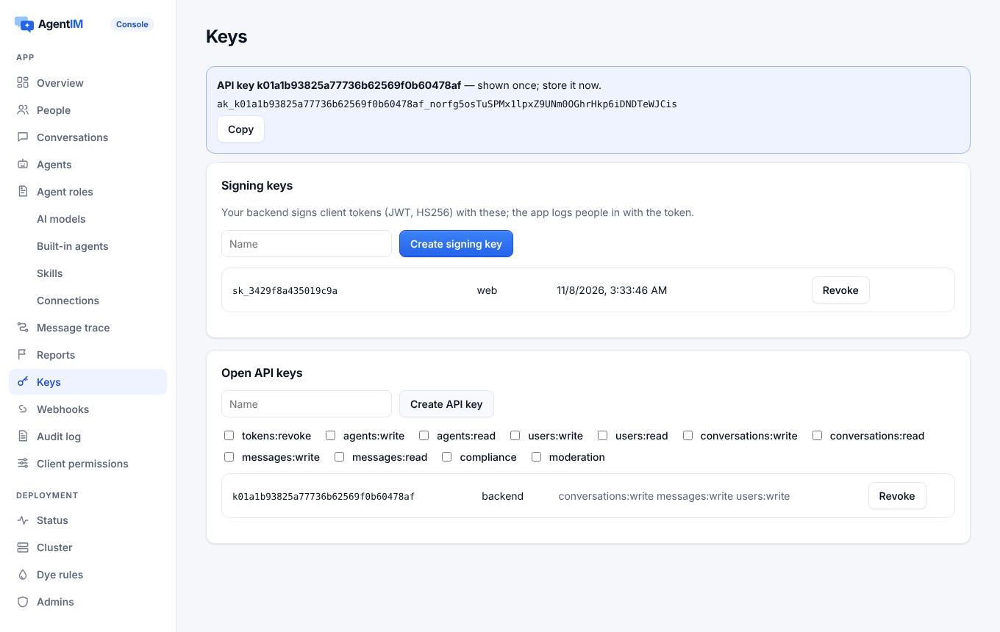

import { Tabs, TabItem } from '@astrojs/starlight/components';
import Capabilities from '../../../../../components/docs/Capabilities.astro';
import Support from '../../../../../components/docs/Support.astro';

<Capabilities>
- AgentIM 里没有密码：你的后端为每个用户签发短期令牌
- 标准 JWT（HS256）：任何库都能签发，也可以用服务端 SDK
- 不停机轮换签名密钥；吊销一把会立刻断开用它登录的用户
- 第一次连接就会创建用户
- 每台设备有自己的同步位置；其他设备会知道有新设备登录
- 登出一台设备、所有设备，或停用用户
- Agent 用自己的密钥，每把对应一台设备，只显示一次
</Capabilities>

## 看一眼

控制台的**密钥**页面：给后端用的签名密钥、API 密钥和 Agent 密钥。



AgentIM 不为你的用户保存账号或密码。你的产品用自己的方式让用户登录，然后你的后端用签名密钥给每个用户签发一个短期**客户端令牌**。AgentIM 信任这个令牌，因为它信任这把密钥。签发不需要调用聊天服务端，所以即使 AgentIM 很忙，登录也照常工作。

## 签名密钥

```sh
agentim signing-key create --name backend   # prints kid and secret, once
agentim signing-key list
agentim signing-key revoke sk_…
```

开发者也可以在[控制台](/zh/docs/operations/dashboard/)（密钥）或管理 API 里管理。可以同时有多把有效的密钥，方便轮换：新建一把、切换后端、吊销旧的。吊销一把密钥会拒绝它签发的所有令牌，并在所有节点上立刻断开这些连接。

## 客户端令牌

客户端令牌是标准 JWT，任何 JWT 库都能签发。服务端 SDK 里有 `createUserToken`（Node）、`create_user_token`（Python）和 `CreateUserToken`（Go）。

```text
header   {"alg": "HS256", "typ": "JWT", "kid": "sk_…"}
claims   {"sub": "maya", "iat": 1792500000, "exp": 1792503600}
```

| 字段 | 规则 |
|---|---|
| `alg` | 只能是 `HS256`。`none` 和其他算法一律拒绝 |
| `kid` | 用哪把签名密钥签的 |
| `sub` | 你的用户 id：1–64 个字母、数字和 `_-.@:` |
| `iat` | 签发时间；比现在晚 60 秒以上的会被拒绝 |
| `exp` | 必填；最多在 `iat` 之后 `auth.max_token_days`（默认 30 天）。没有永久令牌 |

令牌有效期要短，比如一小时。客户端 SDK 在需要令牌时会调用你的 `tokenProvider`：第一次连接、重连和令牌过期时。连接期间过期不会断开：令牌只在连接时检查。

`agentim token sign --user maya --ttl 3600` 用最新的签名密钥签一个，用于本地测试。

### 第一次连接就创建用户

服务端没见过的 id 带着有效令牌连接时，会自动创建这个用户。你的后端可以用[开放 API](/zh/docs/reference/open-api/)（`PUT /v1/users/{id}`）补充资料。已删除的 id、已停用的用户和 Agent 的令牌会被拒绝。`system` 是保留的。

## 设备

应用第一次运行时选一个**设备 id** 并保存下来（1–64 个 `A-Z a-z 0-9 _ -`），连接时带上它，还可以带设备名和平台。服务端第一次见到时注册这台设备。每台设备有自己的同步位置。这个用户的其他在线设备会收到 `device.added`。

30 天没用的设备（`auth.token_idle_days`）会被遗忘。

## 登出

| 范围 | 方式 | 效果 |
|---|---|---|
| 一台设备 | 客户端 SDK 的 `logout()`（本机）、`logout_device`（我的另一台设备），或 `DELETE /v1/users/{id}/devices/{device}` | 断开连接、删除它的同步位置，并拒绝到目前为止在这台设备上签发的所有令牌。应用需要新令牌，之后它就是一台新设备。 |
| 所有设备 | `DELETE /v1/users/{id}/tokens`（范围 `tokens:revoke`） | 到目前为止签发的所有令牌在所有设备上都被拒绝；已连接的设备被断开 |
| 停用 | `POST /v1/users/{id}:deactivate` | 用户无法连接，消息保留。`:reactivate` 恢复 |

令牌不绑定设备。拿到令牌副本的人在它过期前可以用另一个设备 id 使用它。怀疑令牌被盗时，让这个用户在所有设备上登出。这就是令牌有效期要短的原因。

## Agent 密钥

Agent 不用客户端令牌。每个 Agent 有自己的密钥（`atk_…`，256 位随机数，只存哈希）。每把密钥是一台设备，有自己的同步位置。密钥只在创建 Agent 或签发密钥时返回一次：

| | |
|---|---|
| 新密钥 | `POST /v1/agents/{id}/keys`，可同时吊销其他密钥 |
| 吊销 | `DELETE /v1/agents/{id}/keys`（全部）或 `…/keys/{device}`（一把） |
| 命令行 | `agentim admin agent-key helper --revoke-others` |

## 连接

客户端连接 `/ws`。原生客户端和 Agent 在 `Authorization: Bearer …` 里带令牌。浏览器的 WebSocket 不能设请求头，所以浏览器 SDK 用子协议 `agentim` 和 `agentim.bearer.<base64url 令牌>`。令牌绝不放在 URL 里，因为代理会记录 URL。浏览器连接必须来自服务端自己的来源，或 `server.allowed_origins` 里列出的来源。

## 怎么用

<Tabs syncKey="server">
<TabItem label="Node">
```js
import { createUserToken } from '@agentimhq/node';
app.get('/chat-token', (req, res) => res.send(createUserToken({ kid, secret }, req.user.id, { expiresIn: 3600 })));
```
</TabItem>
<TabItem label="Python">
```python
from agentim import create_user_token
token = create_user_token(kid, secret, user.id, expires_in=3600)
```
</TabItem>
<TabItem label="Go">
```go
token, err := agentim.CreateUserToken(kid, secret, user.ID, time.Hour)
```
</TabItem>
<TabItem label="Web 客户端">
```ts
const client = await AgentIMClient.create({
  url: 'https://chat.example.com',
  deviceId: (localStorage.deviceId ??= crypto.randomUUID()),
  tokenProvider: () => fetch('/chat-token').then((r) => r.text()),
});
client.connect();
// later: await client.logout();   // this device
```
</TabItem>
</Tabs>

## 哪些端支持

<Support sdk={['Web', 'React Native', 'iOS', 'Android', 'Flutter', '.NET']} />

## 相关

[服务端 SDK](/zh/docs/server-sdks/) · [开放 API](/zh/docs/reference/open-api/) · [安全](/zh/docs/security/) · [控制台](/zh/docs/operations/dashboard/)
