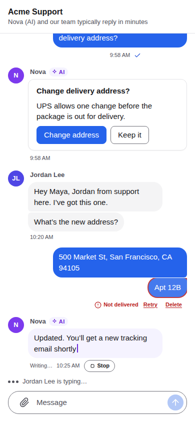

import { Tabs, TabItem } from '@astrojs/starlight/components';
import Capabilities from '../../../../../components/docs/Capabilities.astro';
import Support from '../../../../../components/docs/Support.astro';

<Capabilities>
- 无论怎么断线，每台设备都按顺序、恰好一次收到每个事件
- 离线队列：发送、编辑、已读和卡片回答在网络或应用恢复后发出
- 加密的本地缓存：会话列表和最近的消息立刻显示，离线也可以
- 编辑和发送立刻显示，再由服务端确认
- 一台设备上读过，所有设备都算已读；未读数和 @ 由服务端维护
- 在所有设备上把会话设为免打扰，临时或永久
- 新设备和新成员能看到的历史，有明确的范围
- 自动退避重连，网络恢复时立刻重连
</Capabilities>

## 看一眼

同一个会话在网页和手机上：在一边读过，另一边也是已读。



## 推送只是提示，同步才是事实

服务端把每个事件推送给在线的设备。推送可能丢失：手机休眠、网络断开、慢客户端的队列满了。正确性从不依赖推送。

- **服务端记录每台设备在每个会话里的位置**：设备确认过的最后一个 `seq`。设备不自己说从哪里开始；它请求同步，服务端从它确认过的位置继续。
- **只有正好接得上**这个连接已收到的内容时，推送才会送达。否则设备收到 `resync`，用下一次 `sync` 拉取剩下的。所以一个事件绝不会既被推送又被同步，也绝不会乱序到达。
- **确认只能往前走。** 设备不能确认没发给它的东西，所以伪造确认只会让它漏消息，绝不会多收。
- **流量控制：** 每个会话每批最多 200 个事件，未确认的最多 1,000 个，直到设备确认。

这些都由客户端 SDK 完成。你的应用只看到三样可订阅的东西：连接状态、会话列表和每个会话的消息。

## 客户端 SDK 保存什么

| | |
|---|---|
| **离线队列** | 发送、编辑、撤回、已读、反馈和卡片回答在发送前先保存。连接允许时按顺序只发一次，应用重启后也一样。消息在服务端收到前是 `sending`，只有被服务端按规则拒绝时（不是成员、被拉黑……）才是 `failed`。网络问题、过载和限流都会重试，绝不会变成失败。 |
| **本地缓存** | 会话和消息，在磁盘上加密保存（设备上用 SQLite，浏览器里用 IndexedDB）。启动时会话列表和最近消息立刻显示，离线也可以。 |
| **立刻显示** | 应用显示的是服务端的数据再叠加上队列。编辑立刻显示新文字，确认前标为 `pending`；被拒绝的操作直接消失。 |
| **重连** | 带抖动的指数退避。离线两分钟后大约每分钟重试一次（`suspended`）。网络变化或应用回到前台时立刻重连；收到 `rate_limited` 或 `goaway` 后按服务端要求的时间等待。 |

## 历史

### 新设备

新设备、重装或清空缓存后从小处开始：先拿会话列表，再拿每个会话最近 90 天内最新的 30 条消息。往上滚动会从服务端加载更早的页（每次 50 条）并存入缓存。`jumpTo(seq)` 和"跳到第一条未读"会加载某条消息附近的一页。

没有更早的内容可加载时，`hasOlder` 变为 false，并给出原因：

| `olderEnd` | 含义 |
|---|---|
| `start` | 会话的开头 |
| `visible_from` | 这个成员能看到的起点（他是后来加入的） |
| `retention` | 更早的事件因保留期已被删除 |
| `disabled` | 服务端不允许往前翻页 |

### 新成员能看到的历史

被加进群的人默认能看到最近 30 天内最新的 30 条消息。加人的人可以选别的数量（`history`，0 表示不给，最多 200），会话里所有人都能看到分享了多少。创建会话时就加入的成员从头开始看。Agent 看不到加入之前的内容，除非给了它历史（[Agent](/zh/docs/concepts/agents/)）。

可见起点在加入时就固定了。之后修改服务端设置不会改变现有成员能看到的范围。

### 服务端设置

```toml
[sync]
batch_size = 200       # events per conversation per batch
max_unacked = 1000     # unacknowledged events per conversation
max_gap = 10000        # a device further behind starts over like a new one
device_ttl_days = 30   # a device that acknowledged nothing for this long is forgotten
window_days = 90       # how far back a new device syncs (at most 90)
max_messages = 30      # messages per conversation for a new device
member_messages = 30   # history for a new member
member_days = 30
share_max = 200        # the most history someone adding a member may share

[retention]
days = 180             # 0 keeps everything
```

所有选项见[配置参考](/zh/docs/operations/configuration/)。

## 已读、未读数和免打扰

- `read` 在用户的所有设备上把会话标为已读到某个 `seq`。发一条消息会把它之前的全部标为已读。
- 服务端按会话统计未读消息和 @。编辑、撤回旧消息和系统事件不计数。
- 开启 `read_silences_others`（默认开启）时，已在一台设备上读过的消息不会在其他设备上增加未读或发通知。
- 免打扰（`none`、`all` 或 `mentions`，可设截止时间）保存在服务端，对所有设备生效。免打扰的会话照常同步和统计未读，只是不发通知。

## 保留期

超过 `retention.days` 的事件从每份日志的开头删除，绝不会从中间删。离开时间超过保留期的设备，从仍保留的最早事件开始，并显示"更早的消息已不再保留"。

## 怎么用

<Tabs syncKey="platform">
<TabItem label="Web">
```ts
client.connection.subscribe((c) => showStatus(c.state));      // connected, disconnected, suspended…
const view = client.messages(convId);
view.subscribe((messages) => render(messages));                // sending, failed, pending edits included
if (view.hasOlder) await view.loadOlder();                      // 50 at a time
view.jumpTo(seq);                                               // a page around a message
await client.read(convId);                                      // read on every device
await client.call('set_mute', { conv_id: convId, mode: 'mentions' });
```
</TabItem>
<TabItem label="React">
```tsx
<AgentIM client={client}>
  <ConnectionBanner />           {/* offline, reconnecting… */}
  <Chat convId={convId} />       {/* unread divider, jump to latest, retry a failed send */}
</AgentIM>
```
</TabItem>
<TabItem label="iOS">
```swift
let view = client.messages(convId)
try await view.loadOlder()
client.setNetwork(online: false)      // from NWPathMonitor
client.setForeground(true)            // from the app's scene phase
try await client.read(convId)
```
</TabItem>
<TabItem label="Android">
```kotlin
val view = client.messages(convId)
view.loadOlder()
client.setNetwork(online = false)     // from ConnectivityManager
client.setForeground(true)            // from the process lifecycle
client.read(convId)
```
</TabItem>
</Tabs>

## 哪些端支持

<Support sdk={['Web', 'React Native', 'iOS', 'Android', 'Flutter', '.NET']} ui={['React', 'React Native UI']} note="每个客户端 SDK 都运行同一个 Rust 核心，所以队列、缓存和重试规则在哪里都一样。" />

## 相关

[会话和消息](/zh/docs/concepts/conversations/) · [设备和登录](/zh/docs/concepts/devices-and-login/) · [客户端协议](/zh/docs/reference/client-protocol/) · [配置](/zh/docs/operations/configuration/)
