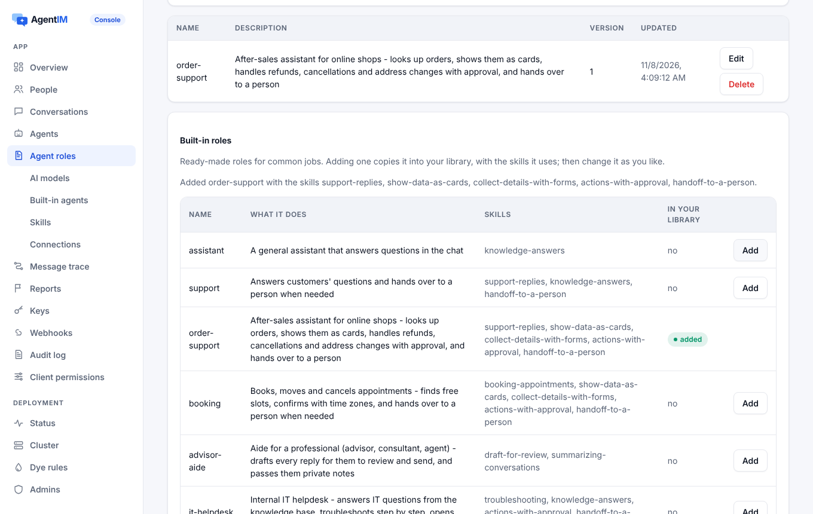

import Capabilities from '../../../../../components/docs/Capabilities.astro';
import Support from '../../../../../components/docs/Support.astro';

<Capabilities>
- 服务端替你运行的 Agent：你这边不用写代码
- 用你自己的密钥接 Claude、OpenAI（含 Codex 模型）、Gemini、DeepSeek 或任意 OpenAI 兼容服务
- 密钥保存前先验证，加密存储，之后不再显示
- 12 个现成角色和 14 个 Skills 可以直接用
- 用你的文件作知识库，回答注明出处，或只按知识库回答
- 连接你的接口和 MCP 服务，写操作可以先审批
- 每分钟、每天和 token 预算限制；每次调用的成本都有记录
</Capabilities>

## 看一眼

控制台的 **Agent 角色**页面：添加一个现成角色，然后选模型启用。



内置 Agent 是由 AgentIM 服务端自己回答的 Agent。你选一个模型服务和模型，之后它在被私聊或被 @ 的会话里回答，以角色指令和会话内容为上下文，流式输出。你这边不运行任何代码。

## 1. 模型服务

在控制台的 **AI 模型**里（或用 `PUT /admin/v1/app/model-services/{name}`）添加服务商和你的密钥：

| 服务商 | `provider` | 模型 |
|---|---|---|
| Claude（Anthropic） | `anthropic` | Anthropic 的模型列表 |
| OpenAI（含 Codex 模型） | `openai` | OpenAI 的模型列表（仅对话模型） |
| Google Gemini | `gemini` | 通过 Google 的 OpenAI 兼容接口 |
| DeepSeek | `deepseek` | DeepSeek 的模型 |
| 任意 OpenAI 兼容服务 | `compatible` | 用你的 `base_url` |

密钥保存前会先到服务商那里验证，加密存储，之后不再显示（只显示最后四位）。部署方也可以用自己的密钥提供服务，密钥从环境变量读取：

```toml
[[ai.builtin]]
name = "claude"
provider = "anthropic"
key_env = "AGENTIM_AI_ANTHROPIC_KEY"   # the key itself never goes in a file
daily_tokens = 2000000                  # per app per day; 0 = no limit
```

用部署方的密钥时，只能用价格已知的模型，这样每次调用的成本都清楚（价格表在 `builtin/prices.toml`，可以用 `ai.prices_file` 替换）。

## 2. Agent

在**内置 Agent**里，从内置库（见下文）选一个现成角色，指定维护人、服务和模型启用。这会创建一个带这个角色及其 Skills 的团队 Agent。也可以把任何已有的 Agent 变成内置的：

```bash
curl -X PUT "$AGENTIM/admin/v1/app/agents/helper/assistant" \
  -H "Authorization: Bearer $ADMIN_KEY" -H "content-type: application/json" \
  -d '{"service": "claude", "model": "claude-sonnet-5-5",
       "settings": {"replies_per_minute": 10, "replies_per_day": 1000, "only_knowledge": false}}'
```

它的指令就是它的[角色](/zh/docs/ai/roles-and-skills/)（一个 Markdown 文件）。每条消息恰好得到一个回复，跨重启和集群节点也一样。模型答不了时，Agent 会说明（你的 `fallback` 文字）；触发限制（每分钟和每天的回复数、每个服务每天的 token）时，会回一个简短提示，而不调用模型。

### 内置库

AgentIM 自带 12 个角色和 14 个 Skills，格式和 Claude Code 的 Agent、Agent Skills 相同。可以在控制台（**Agent 角色**和 **Skills** 的"内置角色""内置 Skills"）或用管理 API 添加。添加角色会把它复制到你的库里，并加入它用到、你还没有的 Skills；之后可以随意修改你的副本。

| 角色 | 用途 |
|---|---|
| `assistant` | 聊天里的一般问题 |
| `support` | 客户问题；需要时转人工 |
| `order-support` | 售后：订单、退款、取消、改地址，需要时先审批 |
| `booking` | 预约、改约和取消预约 |
| `advisor-aide` | 为专业人士起草回复供其发送，并提供私下备注 |
| `it-helpdesk` | 内部 IT 问题、排障、工单 |
| `hr-helpdesk` | 内部 HR 政策咨询和申请 |
| `sales` | 潜在客户咨询、线索表单、预约通话 |
| `notes` | 会议纪要和总结 |
| `translator` | 翻译消息 |
| `moderator` | 提醒大家遵守规则，并举报 |
| `task-lead` | 带领多个 Agent 完成一个任务 |

Skills 教的是这些工作共有的做事方法：`support-replies`、`handoff-to-a-person`、`actions-with-approval`、`show-data-as-cards`、`collect-details-with-forms`、`knowledge-answers`、`booking-appointments`、`draft-for-review`、`troubleshooting`、`summarizing-conversations`、`meeting-notes`、`translation`、`content-moderation`、`task-coordination`。

```bash
curl -X POST "$AGENTIM/admin/v1/app/library/roles/order-support" -H "Authorization: Bearer $ADMIN_KEY"
# {"role": "order-support", "skills_added": ["support-replies", "show-data-as-cards", ...]}
curl "$AGENTIM/admin/v1/app/library/roles" -H "Authorization: Bearer $ADMIN_KEY"
# each role with "installed" and "current"; POST with {"replace": true} restores the shipped text
```

## 3. 知识库

给 Agent 上传文件（`PUT …/agents/{id}/knowledge/{文件名}`，文件作为请求体）：Markdown、纯文本、CSV、JSON 或 PDF，每个最多 5 MB，最多 50 个。文字加密存储，每个问题都会检索；最匹配的部分放进提示词，Agent 会注明出处。开启 `only_knowledge` 时只按知识库回答，开启 `handoff` 时把知识库覆盖不到的问题转给人。

## 4. Skills 和连接

角色头部写明它的 Agent 用哪些 Skills 和连接：

```markdown
---
name: support
description: Answers customers
skills: [refunds]
mcp: [shop]
apis: [orders]
---
Answer customers politely…
```

- **Skills** 用 Agent Skills 格式：一个 `SKILL.md`（带 `name` 和 `description`）加参考文件，在 **Skills** 或用 `PUT /admin/v1/app/skills/{name}` 管理。Agent 能看到每个 Skill 的名字和说明，需要时才加载其余内容。脚本不会执行。
- **连接**是远程 MCP 服务（Streamable HTTP）和用 OpenAPI 3 文档描述的 HTTP 接口，在**连接**或用 `PUT /admin/v1/app/connections/{name}` 管理。它们的工具变成模型能调用的函数。除非你允许写操作，否则只用只读工具。设为**先问**（`writes: confirm`）时，每个会改变数据的调用都要等待：Agent 请它正在回答的人批准（请求显示工具和参数，从不显示凭据），批准后用显示过的参数执行一次，再告诉对方结果。被拒绝、过期（一小时）或连接不再允许时，调用不会执行。凭据加密保存，只发往连接自己的地址。

你用 [Agent SDK](/zh/docs/agent-sdks/) 自己运行的 Agent 会在配置里拿到同样的 Skills 和连接。SDK 可以把它们写到 Claude Code 和 Claude Agent SDK 读取的位置（`.claude/skills`、`.mcp.json`）：见[写到磁盘上的 Skills 和 MCP 服务](/zh/docs/agent-sdks/#skills-and-mcp-servers-on-disk)。

## 用量和成本

`GET /admin/v1/app/assistants/usage` 列出每次模型调用的 token（输入、输出、缓存读写）和以纳美元计的成本，从不包含提示词或回复。在 AgentIM 云服务上，Pro 和 Scale 套餐包含内置密钥，token 按服务商官方价格从预付的 AI 额度里扣除；第一次充值时选择服务商。

## 哪些端支持

<Support sdk={['Web', 'React Native', 'iOS', 'Android', 'Flutter', '.NET']} ui={['React', 'React Native UI']} />

## 相关

[角色和 Skills](/zh/docs/ai/roles-and-skills/) · [连接你的系统](/zh/docs/ai/connections/) · [Agent 作为成员](/zh/docs/concepts/agents/) · [管理 API](/zh/docs/reference/admin-api/)
